<picture><source media="(prefers-color-scheme: dark)" srcset="assets/dist/hero-marketing-jobs-dark.svg"><source media="(prefers-color-scheme: light)" srcset="assets/dist/hero-marketing-jobs-light.svg"></picture>

<a href="#open-jobs"><picture><source media="(prefers-color-scheme: dark)" srcset="assets/dist/btn-primary-dark.svg"><source media="(prefers-color-scheme: light)" srcset="assets/dist/btn-primary-light.svg"></picture></a>

<a href="https://chromewebstore.google.com/detail/gmdkffapbfeanfecgcodocfcefldjaho"><picture><source media="(prefers-color-scheme: dark)" srcset="assets/dist/btn-extension-dark.svg"><source media="(prefers-color-scheme: light)" srcset="assets/dist/btn-extension-light.svg"></picture></a>&nbsp;&nbsp;<a href="https://jobhacki.com/login-v2"><picture><source media="(prefers-color-scheme: dark)" srcset="assets/dist/btn-account-dark.svg"><source media="(prefers-color-scheme: light)" srcset="assets/dist/btn-account-light.svg"></picture></a>

Join the JobHacki Discord community to talk about jobs with other job seekers.

<a href="https://discord.gg/RApjXmgnwA">Share your thoughts on marketing jobs with people in #leads-marketing.</a>

<table><tr><td align="center" valign="top"><h3>9,337</h3>open marketing jobs in this list (latest refresh)</td><td align="center" valign="top"><h3>150</h3>freshest rows shown below</td><td align="center" valign="top"><h3>2026-11-09</h3>newest posting date</td></tr></table>

Snapshot 2026-11-09 12:20 UTC

**Hi, I'm Sophia, JobHacki's AI assistant. Pick a list, inspect a role, and follow its employer link.**

Explore marketing, growth, and brand roles in this fresh slice of jobs taken from employers' own hiring systems. Updated Nov 9, 2026.

[Back to all 12 lists](https://github.com/Jobhacki/jobs)

 

<picture><source media="(prefers-color-scheme: dark)" srcset="assets/dist/divider-dark.svg"><source media="(prefers-color-scheme: light)" srcset="assets/dist/divider-light.svg"></picture>

## Open jobs

**9,337 open marketing jobs seen in the latest refresh.** The table shows the freshest 150. **Last updated: 2026-11-09 12:20 UTC.** Apply links go to the employer's career page or hiring system.

<!-- JOBS_TABLE_START -->
| Role | Employer | Location | Pay | Posted | Apply |
|---|---|---|---|---|---|
| Communications & Public Involvement Coordinator | WSP | Washington, DC, United States |  | 2026-11-09 | [Apply](https://emit.fa.ca3.oraclecloud.com/hcmUI/CandidateExperience/en/sites/CX_2001/job/97963) |
| Marketing Assistant, Ballantine Bantam Dell (Hybrid) | Bertelsmann-Jobs | New York, New York (NY), US |  | 2026-11-09 | [Apply](https://jobs.smartrecruiters.com/Bertelsmann-Jobs/744000160578774) |
| Marketing Manager - United States | light-inc | United States / New York |  | 2026-11-09 | [Apply](https://jobs.ashbyhq.com/light-inc/e3709c0c-5e4a-47cb-bcd2-cd0b8a26b634) |
| Technical Marketing Engineering Technical Leader | cisco | Milpitas, California, US |  | 2026-11-09 | [Apply](https://cisco.wd5.myworkdayjobs.com/en-US/cisco_careers/job/Milpitas-California-US/Technical-Marketing-Engineering-Technical-Leader_2023690) |
| Director, Product Marketing DSX | NVIDIA | 2 Locations |  | 2026-11-09 | [Apply](https://nvidia.wd5.myworkdayjobs.com/en-US/NVIDIAExternalCareerSite/job/US-CA-Santa-Clara/Director--Product-Marketing-DSX_JR2029288) |
| Senior Marketing Technology Specialist | Domino's | Ann Arbor, MI, US |  | 2026-11-09 | [Apply](https://jobs.smartrecruiters.com/Dominos/744000160502704) |
| Growth Lead | Encord | New York |  | 2026-11-09 | [Apply](https://jobs.ashbyhq.com/encord/00893c0a-72c0-40ff-b2ff-a0fbfde9d84f) |
| Webflow Guru/Website Manager | veracode | Burlington, MA OR US Remote |  | 2026-11-08 | [Apply](https://www.veracode.com/career/job?gh_jid=8934577002) |
| Social Content Creator | gorgias | New York City |  | 2026-11-08 | [Apply](https://jobs.ashbyhq.com/gorgias/4ba2ddf6-4a36-4892-a548-433e13ac7698) |
| Growth Associate | Encord | New York |  | 2026-11-08 | [Apply](https://jobs.ashbyhq.com/encord/554d188d-47fa-4701-8041-21cc1975a7a4) |
| Specialist III-IC Marketing Research | bmo | Chicago, IL, USA |  | 2026-11-08 | [Apply](https://bmo.wd3.myworkdayjobs.com/en-US/privileged/job/Chicago-IL-USA/Specialist-III-IC-Marketing-Research_R260031186) |
| Specialist III-IC Marketing Research | bmo | Chicago, IL, USA |  | 2026-11-08 | [Apply](https://bmo.wd3.myworkdayjobs.com/en-US/privileged/job/Chicago-IL-USA/Specialist-III-IC-Marketing-Research_R260031187) |
| Communications Specialist | AlphabeInsightInc | Miami, FL, US |  | 2026-11-08 | [Apply](https://jobs.smartrecruiters.com/AlphabeInsightInc/744000160492159) |
| Head of Marketing | clera | San Francisco |  | 2026-11-08 | [Apply](https://jobs.ashbyhq.com/Clera/b7946694-962a-4884-bdfa-40dbecb5ea98) |
| Senior Product Marketing Manager, Legal AI | ironcladhq | San Francisco |  | 2026-11-08 | [Apply](https://jobs.ashbyhq.com/ironcladhq/553e9083-2d24-4dba-8ee1-75f47095b926) |
| Head of OOH Media ($250k - $400k +bonus) | batoncorporation | New York |  | 2026-11-08 | [Apply](https://jobs.ashbyhq.com/batoncorporation/5cdeb84b-39fc-465e-a730-b13b69d2e3d4) |
| GROWTH OPPORTUNITIES Shift Lead (07567) - 5554 Daybreak Pkwy | Domino's | South Jordan, UT, US |  | 2026-11-08 | [Apply](https://jobs.smartrecruiters.com/Dominos/744000160457969) |
| Executive Communications Manager, Americas Software and Services Sales (West Co... | cisco | 6 Locations |  | 2026-11-08 | [Apply](https://cisco.wd5.myworkdayjobs.com/en-US/cisco_careers/job/San-Jose-California-US/Executive-Communications-Manager--Americas-Software-and-Services-Sales--West-Coast-_2028906) |
| Senior Product Marketing Manager, AI Infrastructure | NVIDIA | US, CA, Santa Clara |  | 2026-11-08 | [Apply](https://nvidia.wd5.myworkdayjobs.com/en-US/NVIDIAExternalCareerSite/job/US-CA-Santa-Clara/Senior-Product-Marketing-Manager--AI-Infrastructure_JR2028861) |
| Social Media Specialist (Part-Time) | tradeify | Boca Raton, FL | $36k-40k/yr | 2026-11-07 | [Apply](https://jobs.ashbyhq.com/tradeify/bc50fc4b-bfd0-4e03-b932-a86b18237723) |
| Growth & Marketing Intern / New Grad | clera | San Francisco |  | 2026-11-07 | [Apply](https://jobs.ashbyhq.com/Clera/bb423c6c-3d23-431f-875e-9240f17cb83b) |
| Marketing Designer | Anchour | New Gloucester, ME |  | 2026-11-07 | [Apply](https://anchour.breezy.hr/p/e0dc71c53359-marketing-designer) |
| Training and Communications Manager, Global Ethics & Integrity | Salesforce | 4 Locations |  | 2026-11-07 | [Apply](https://salesforce.wd12.myworkdayjobs.com/en-US/External_Career_Site/job/District-of-Columbia---Washington/Training-and-Communications-Manager--Global-Ethics---Integrity_JR367124) |
| Senior Growth / Demand Generation Manager | nectar-social | Palo Alto, CA | $165k-215k/yr | 2026-11-07 | [Apply](https://jobs.ashbyhq.com/nectar/040eb4a2-8197-408a-af29-0e4a957b55e9) |
| Marketing Lead | Flint | San Francisco |  | 2026-11-07 | [Apply](https://jobs.ashbyhq.com/flint/cbda8ff2-564e-4447-b547-742feb87afe9) |
| Head of Marketing | David AI | San Francisco | $210k-250k/yr | 2026-11-07 | [Apply](https://jobs.ashbyhq.com/david-ai/1e62804a-ddad-4432-8796-7431aa47d0c3) |
| Senior Demand Marketing Manager, Velocity | envoy | San Francisco, CA | $155k-168.75k/yr | 2026-11-07 | [Apply](https://jobs.ashbyhq.com/Envoy/95e22dd1-338a-4137-9560-7a91ffcbe8fd) |
| Director of Digital Marketing | fastretailing | New York, NY |  | 2026-11-07 | [Apply](https://fastretailing.wd3.myworkdayjobs.com/en-US/headquarters_us_uniqlo/job/New-York-NY/Digital-Marketing-Director_R00000004166544) |
| Senior Marketing Specialist | zillow | Remote-USA |  | 2026-11-07 | [Apply](https://zillow.wd5.myworkdayjobs.com/en-US/zillow_group_external/job/Remote-USA/Senior-Marketing-Specialist_P751602) |
| Head of Integrated Marketing | empower | Nationwide Remote |  | 2026-11-07 | [Apply](https://empower.wd12.myworkdayjobs.com/en-US/empower/job/Nationwide-Remote/Head-of-Integrated-Marketing_R0063470) |
| Frontline Marketing Manager | zillow | Remote-USA |  | 2026-11-07 | [Apply](https://zillow.wd5.myworkdayjobs.com/en-US/zillow_group_external/job/Remote-USA/Frontline-Marketing-Manager_P751598-1) |
| Global Product Marketing IV/V | amat | Santa Clara,CA |  | 2026-11-07 | [Apply](https://amat.wd1.myworkdayjobs.com/en-US/external/job/Santa-ClaraCA/Global-Product-Marketing-IV-V_R2633241) |
| Marketing Representative | cat | Houston, Texas |  | 2026-11-07 | [Apply](https://cat.wd5.myworkdayjobs.com/en-US/caterpillarcareers/job/Houston-Texas/Marketing-Representative_R0000402040) |
| Marketing Specialist - Lead Generation & Agent Relations | abb | USA, TN, Memphis |  | 2026-11-07 | [Apply](https://abb.wd3.myworkdayjobs.com/en-US/external_career_page/job/USA-TN-Memphis/Marketing-Specialist---Lead-Generation---Agent-Relations_JR00052912) |
| (USA) Senior Manager, Marketing Planning And Strategy | Walmart | 2 Locations |  | 2026-11-07 | [Apply](https://walmart.wd504.myworkdayjobs.com/en-US/WalmartExternal/job/USA-221-River-St-NJ-HOBOKEN-Home-Office/XMLNAME--USA--Senior-Manager--Marketing-Planning-And-Strategy_R-2686310-1) |
| Marketing Research & Intelligence | HP | Palo Alto, California, United States of America |  | 2026-11-07 | [Apply](https://hp.wd5.myworkdayjobs.com/en-US/ExternalCareerSite/job/Palo-Alto-California-United-States-of-America/Marketing-Research---Intelligence_3160237-1) |
| 2027 Intern — Employee Communications | Adobe | 2 Locations |  | 2026-11-07 | [Apply](https://adobe.wd5.myworkdayjobs.com/en-US/external_experienced/job/San-Jose/XMLNAME-2027-Intern---Employee-Communications_R173412) |
| eCommerce Marketing Manager- Amazon | belkin | 2 Locations |  | 2026-11-07 | [Apply](https://belkin.wd5.myworkdayjobs.com/en-US/belkin_careers/job/El-Segundo/eCommerce-Marketing-Manager--Amazon_10013259) |
| Program Management Specialist, Product Marketing & GTM Operations | darktrace | 4 Locations |  | 2026-11-07 | [Apply](https://darktrace.wd3.myworkdayjobs.com/en-US/darktaceexternal/job/Massachusetts-Remote/Program-Management-Specialist--Product-Marketing---GTM-Operations_JR102300-1) |
| 07 Manager - MP - Marketing | nilfisk | Plymouth, MN |  | 2026-11-07 | [Apply](https://nilfisk.wd3.myworkdayjobs.com/en-US/nilfisk/job/Plymouth-MN/XMLNAME-07-Manager---MP---Marketing_R018035) |
| (USA) Manager, Marketing Planning And Strategy | Walmart | 2 Locations |  | 2026-11-07 | [Apply](https://walmart.wd504.myworkdayjobs.com/en-US/WalmartExternal/job/USA-221-River-St-NJ-HOBOKEN-Home-Office/XMLNAME--USA--Manager--Marketing-Planning-And-Strategy_R-2683762-1) |
| Product Marketing Lead - Bloomberg Tax | bloomberg | Arlington, VA - 1801 S Bell (INDG) |  | 2026-11-07 | [Apply](https://bloomberg.wd1.myworkdayjobs.com/en-US/bloombergindustrygroup_external_career_site/job/Arlington-VA---1801-S-Bell-INDG/Team-Lead---Product-Marketing---Bloomberg-Tax_144791-1) |
| Senior Field Marketing Coordinator, Midwest | axis | USA - IL - Chicago |  | 2026-11-07 | [Apply](https://axis.wd3.myworkdayjobs.com/en-US/external_career_site/job/USA---IL---Chicago/Senior-Field-Marketing-Coordinator--Midwest_R-124293) |
| Associate Director, US HCP Peer-to-Peer Marketing, GMG & NMOSD, Rare Neurology | astrazeneca | US - Boston - MA |  | 2026-11-07 | [Apply](https://astrazeneca.wd3.myworkdayjobs.com/en-US/careers/job/US---Boston---MA/Associate-Director--US-HCP-Peer-to-Peer-Marketing--GMG---NMOSD--Rare-Neurology_R-263746) |
| (USA) Manager, Marketing Planning And Strategy | Walmart | (USA) 221 River St NJ HOBOKEN Home Office |  | 2026-11-07 | [Apply](https://walmart.wd504.myworkdayjobs.com/en-US/WalmartExternal/job/USA-221-River-St-NJ-HOBOKEN-Home-Office/XMLNAME--USA--Manager--Marketing-Planning-And-Strategy_R-2680931-1) |
| Associate Marketing Manager Emerging Brands Experiential | bf | Kentucky, Louisville |  | 2026-11-07 | [Apply](https://bf.wd5.myworkdayjobs.com/en-US/usa_canada/job/Kentucky-Louisville/Associate-Marketing-Manager-Emerging-Brands-Experiential_JR-00010564-1) |
| Manager, Marketing Analytics | rwlasvegas | Resorts World Las Vegas |  | 2026-11-07 | [Apply](https://rwlasvegas.wd501.myworkdayjobs.com/en-US/rwlv_external_careers/job/Resorts-World-Las-Vegas/Manager--Marketing-Analytics_JR-04140) |
| Communications Data Analyst | chevron | 2 Locations |  | 2026-11-07 | [Apply](https://chevron.wd5.myworkdayjobs.com/en-US/jobs/job/Houston-Texas-United-States-of-America/Communications-Data-Analyst_R000069547) |
| Senior Communications Research and Impact Advisor | chevron | 2 Locations |  | 2026-11-07 | [Apply](https://chevron.wd5.myworkdayjobs.com/en-US/jobs/job/Houston-1400-Smith-Street/Communications-Measurement---Insights-Analyst_R000069548) |
| Marketing & PR Manager - Hardin | bhs | Elizabethtown, KY |  | 2026-11-07 | [Apply](https://bhs.wd1.myworkdayjobs.com/en-US/careers/job/Elizabethtown-KY/Marketing---PR-Manager---Hardin_R26109548) |
| Integrated Marketing Associate | infobip | Chicago (USA) |  | 2026-11-07 | [Apply](https://infobip.wd3.myworkdayjobs.com/en-US/infobipcareers/job/Chicago-USA/Integrated-Marketing-Associate_JR105122-1) |
| Product Marketing Manager | zillow | Remote-USA |  | 2026-11-07 | [Apply](https://zillow.wd5.myworkdayjobs.com/en-US/zillow_group_external/job/Remote-USA/Product-Marketing-Manager_P751596-1) |
| Worldwide Integrated Marketing Manager (ACS) | HP | 2 Locations |  | 2026-11-07 | [Apply](https://hp.wd5.myworkdayjobs.com/en-US/ExternalCareerSite/job/Fort-Collins-Colorado-United-States-of-America/Worldwide-Integrated-Marketing-Manager--ACS-_3170513-1) |
| Marketing Coordinator | axos | San Diego, CA |  | 2026-11-07 | [Apply](https://axos.wd5.myworkdayjobs.com/en-US/axos/job/San-Diego-CA/Marketing-Coordinator_JR5870) |
| Coastal Reserve Communications Specialist | nc | Carteret County, NC |  | 2026-11-07 | [Apply](https://nc.wd108.myworkdayjobs.com/en-US/nc_careers/job/Carteret-County-NC/Coastal-Reserve-Communications-Specialist_JR-127781-1) |
| Director, Marketing Analytics | bannerhealth | Banner Health Corp Phoenix (2901 N Central Ave) |  | 2026-11-07 | [Apply](https://bannerhealth.wd108.myworkdayjobs.com/en-US/careers/job/Banner-Health-Corp-Phoenix-2901-N-Central-Ave/Director--Marketing-Analytics_R4456102) |
| Product Marketing Manager, AI Infrastructure & Software Ecosystem | cisco | 2 Locations |  | 2026-11-07 | [Apply](https://cisco.wd5.myworkdayjobs.com/en-US/cisco_careers/job/San-Jose-California-US/Product-Marketing-Manager--AI-Infrastructure---Software-Ecosystem_2025726) |
| Creative Technologist – Creative Marketing & Design Innovation | verizon | New York, New York |  | 2026-11-07 | [Apply](https://verizon.wd12.myworkdayjobs.com/en-US/verizon-careers/job/New-York-New-York/Creative-Technologist---Creative-Marketing---Design-Innovation_R-1103188-1) |
| Creative Director, Creative Marketing & Design Innovation | verizon | New York, New York |  | 2026-11-07 | [Apply](https://verizon.wd12.myworkdayjobs.com/en-US/verizon-careers/job/New-York-New-York/Creative-Director--Creative-Marketing---Design-Innovation_R-1103187) |
| Senior Director, Global Marketing Cell Therapy | astrazeneca | US - Santa Monica - CA |  | 2026-11-07 | [Apply](https://astrazeneca.wd3.myworkdayjobs.com/en-US/careers/job/US---Santa-Monica---CA/Senior-Director--Global-Marketing-Cell-Therapy_R-260460) |
| Brand Marketing Manager | essity | Charlotte, NC |  | 2026-11-07 | [Apply](https://essity.wd3.myworkdayjobs.com/en-US/job_opportunities/job/Charlotte-NC/Brand-Marketing-Manager_Essity266493) |
| Director of Sales & Marketing | atriumhospitality | Greenville, SC |  | 2026-11-07 | [Apply](https://atriumhospitality.wd5.myworkdayjobs.com/en-US/atriumhospitality/job/Greenville-SC/Director-of-Sales---Marketing_R50791) |
| Vice President, Product Marketing (Defense) | dataminr | Arlington, VA |  | 2026-11-07 | [Apply](https://dataminr.wd12.myworkdayjobs.com/en-US/dataminr/job/Arlington-VA/Vice-President--Product-Marketing--Defense-_JR2136) |
| Social Media Manager | nc | Wake County, NC |  | 2026-11-07 | [Apply](https://nc.wd108.myworkdayjobs.com/en-US/nc_careers/job/Wake-County-NC/Social-Media-Manager_JR-127958) |
| Senior Marketing Partner | Avera Health | Sioux Center, IA |  | 2026-11-07 | [Apply](https://avera.wd5.myworkdayjobs.com/en-US/avera-careers/job/Sioux-Center-IA/Senior-Marketing-Partner_R-260031233) |
| Modular Growth Leader | NFPA Global Solutions Inc. | Remote Worker - N/A |  | 2026-11-07 | [Apply](https://recruiting.paylocity.com/Recruiting/Jobs/Details/4587366) |
| Director of Sales and Marketing | Boar's Head Resort | CHARLOTTESVILLE, VA |  | 2026-11-07 | [Apply](https://recruiting.paylocity.com/Recruiting/Jobs/Details/4617672) |
| Marketing Specialist – Content and Insights | alterra | Enumclaw, WA |  | 2026-11-07 | [Apply](https://alterra.wd1.myworkdayjobs.com/en-US/crystalmountain/job/Enumclaw-WA/Marketing-Specialist---Content-and-Insights_JR136660-1) |
| Precision Oncology Marketing Specialist | abbott | 3 Locations |  | 2026-11-07 | [Apply](https://abbott.wd5.myworkdayjobs.com/en-US/abbottcareers/job/United-States---Wisconsin---Madison/Precision-Oncology-Marketing-Specialist_31163130-1) |
| AI Marketing Coordinator | onni | Chicago |  | 2026-11-07 | [Apply](https://onni.wd10.myworkdayjobs.com/en-US/onni_external_careers/job/Chicago/AI-Marketing-Coordinator_R-103010) |
| Manager, Corporate Communications and Public Relations (Global Hospitality) - H... | bestwestern | Phoenix, AZ |  | 2026-11-07 | [Apply](https://bestwestern.wd1.myworkdayjobs.com/en-US/careers/job/Phoenix-AZ/Manager--Corporate-Communications-and-Public-Relations--Global-Hospitality-_R5198) |
| Senior Digital Marketing Associate | betmgminc | 2 Locations |  | 2026-11-07 | [Apply](https://betmgminc.wd5.myworkdayjobs.com/en-US/betmgm/job/Hybrid-New-Jersey/Sr-Digital-Marketing-Associate_JR100800) |
| Senior Manager, NAMER Industry Partnerships & Field Marketing | procore | 2 Locations |  | 2026-11-07 | [Apply](https://procore.wd12.myworkdayjobs.com/en-US/procore_external_careers/job/US---Texas---Austin/Senior-Manager--NAMER-Industry-Partnerships---Field-Marketing_R0018775-1) |
| Operations Manager, Marketing & Communications | acrisure | 4 Locations |  | 2026-11-07 | [Apply](https://acrisure.wd1.myworkdayjobs.com/en-US/acrisure/job/100-Ottawa-Ave-Sw----GRAND-RAPIDS-MI/Operations-Manager--Marketing---Communications_JR114484) |
| Senior Regional Marketing Manager for Inductors (m/f/d) | vishay | 5 Locations |  | 2026-11-07 | [Apply](https://vishay.wd3.myworkdayjobs.com/en-US/vishaycareers/job/Selb-DE/Senior-Regional-Marketing-Manager-for-Inductors--m-f-d-_JR-17044) |
| Digital Communications Coordinator | The Moorings Yacht and Country Club | Vero Beach, FL |  | 2026-11-06 | [Apply](https://recruiting.paylocity.com/Recruiting/Jobs/Details/4648779) |
| Marketing Specialist | NAC Inc | Seattle, WA |  | 2026-11-06 | [Apply](https://recruiting.paylocity.com/Recruiting/Jobs/Details/4649184) |
| Marketing Specialist | NAC Inc | Los Angeles, CA |  | 2026-11-06 | [Apply](https://recruiting.paylocity.com/Recruiting/Jobs/Details/4649715) |
| Marketing Senior Manager - Accenture Edge | accenture |  |  | 2026-11-06 | [Apply](https://accenture.wd103.myworkdayjobs.com/en-US/accenturecareers/job/Chicago-Accenture-Tower-Corp/Marketing-Senior-Manager---Accenture-Edge_R00368362-1) |
| Regional Marketing Specialist, Florida | Eye Health America, LLC | Fort Myers, FL |  | 2026-11-06 | [Apply](https://recruiting.paylocity.com/Recruiting/Jobs/Details/4647562) |
| Marketing Director | Diocese of Manchester | Gilmanton Iron Works, NH |  | 2026-11-06 | [Apply](https://recruiting.paylocity.com/Recruiting/Jobs/Details/4637305) |
| Communications Specialist | Del-Co Water Company, Inc. | Delaware, OH |  | 2026-11-06 | [Apply](https://recruiting.paylocity.com/Recruiting/Jobs/Details/4649481) |
| Communications Specialist and Technical Writer - Defense Health Agency (DHA) | KSA Integration | VA |  | 2026-11-06 | [Apply](https://recruiting.paylocity.com/Recruiting/Jobs/Details/4647910) |
| Communications Manager | Immanuel Christian School | Springfield, VA |  | 2026-11-06 | [Apply](https://recruiting.paylocity.com/Recruiting/Jobs/Details/4647172) |
| Sr. Digital Marketing Manager | Postino WineCafe | Phoenix, AZ |  | 2026-11-06 | [Apply](https://recruiting.paylocity.com/Recruiting/Jobs/Details/4649983) |
| Marketing Analyst/Campaign Manager | onsemi | Phoenix, AZ, United States |  | 2026-11-06 | [Apply](https://hctz.fa.us2.oraclecloud.com/hcmUI/CandidateExperience/en/sites/CX_1001/job/2507175) |
| Communications Specialist – Public Safety Awareness | Southern Company | Birmingham, AL, United States |  | 2026-11-06 | [Apply](https://emje.fa.us6.oraclecloud.com/hcmUI/CandidateExperience/en/sites/CX_1001/job/22648) |
| Regional Marketing Manager, Property & Buildings | WSP | Dallas, TX, United States |  | 2026-11-06 | [Apply](https://emit.fa.ca3.oraclecloud.com/hcmUI/CandidateExperience/en/sites/CX_2001/job/98782) |
| Senior Growth Lead | Fortive | United States |  | 2026-11-06 | [Apply](https://ejta.fa.us6.oraclecloud.com/hcmUI/CandidateExperience/en/sites/CX_2001/job/11277) |
| Shared Services Internal Communications Specialist | NOV | Houston, TX, United States |  | 2026-11-06 | [Apply](https://egay.fa.us6.oraclecloud.com/hcmUI/CandidateExperience/en/sites/CX_4001/job/45519) |
| Senior Marketing Writer | NOV | Houston, TX, United States |  | 2026-11-06 | [Apply](https://egay.fa.us6.oraclecloud.com/hcmUI/CandidateExperience/en/sites/CX_4001/job/45450) |
| Vice President, Marketing | Michael Baker International | Alexandria, VA, United States |  | 2026-11-06 | [Apply](https://ebxs.fa.us2.oraclecloud.com/hcmUI/CandidateExperience/en/sites/CX_2/job/310168) |
| Associate Targeting Strategist | WebMD | United States |  | 2026-11-06 | [Apply](https://jobs.jobvite.com/internetbrands/job/ozT1AfwN) |
| Head of Communications & Media Relations | USA Volleyball |  |  | 2026-11-06 | [Apply](https://recruiting.paylocity.com/Recruiting/Jobs/Details/4649987) |
| 2027 Spring Internship / Frisco Bowl / Marketing & Digital Media | FC Dallas | Frisco, TX, United States |  | 2026-11-06 | [Apply](https://jobs.jobvite.com/fcdallas/job/ozn4Afwk) |
| Senior Marketing Manager | Impact Genome | Washington, DC |  | 2026-11-06 | [Apply](https://recruiting.paylocity.com/Recruiting/Jobs/Details/4647847) |
| Senior Marketing Specialist - Hybrid Role | ADP employer 81e5c688 | Plano, TX, US |  | 2026-11-06 | [Apply](https://workforcenow.adp.com/mascsr/default/mdf/recruitment/recruitment.html?cid=81e5c688-d1ca-4244-b1af-191c840f5703&ccId=19000101_000001&jobId=596536&lang=en_US&source=CC2) |
| Communications Associate | vast | Long Beach, California, United States |  | 2026-11-06 | [Apply](https://boards.greenhouse.io/vast/jobs/4728063006?gh_jid=4728063006) |
| Senior Video Editor | Datadog | New York, New York, USA |  | 2026-11-06 | [Apply](https://careers.datadoghq.com/detail/8350101/?gh_jid=8350101) |
| Senior Growth Marketer (Veterinarians) | roo | Remote |  | 2026-11-06 | [Apply](https://job-boards.greenhouse.io/roo/jobs/5476152008) |
| Head of Growth | avathon | Pleasanton, California, United States |  | 2026-11-06 | [Apply](https://avathon.com/company/careers-job-listing/?gh_jid=4752283005) |
| Sr. Director, Brand and Communications | avathon | Pleasanton, California, United States |  | 2026-11-06 | [Apply](https://avathon.com/company/careers-job-listing/?gh_jid=4752280005) |
| LA Galaxy, Sr Manager, Paid Media | aegworldwide | Carson, CA |  | 2026-11-06 | [Apply](https://job-boards.greenhouse.io/aegworldwide/jobs/8934141002) |
| Social Media Manager | Premier Community Supports | Medford, OR |  | 2026-11-06 | [Apply](https://recruiting.paylocity.com/Recruiting/Jobs/Details/4648727) |
| (Mid Level) Marketing Manager / Marketing Analyst - Digital, Brand, Partnership... | JND | DFW, TX |  | 2026-11-06 | [Apply](https://jnd-inc.breezy.hr/p/e816034ddc13-mid-level-marketing-manager-marketing-analyst-digital-brand-partnership-social-insights-261101-8) |
| Director of Marketing, Communications & Public Affairs | KittitasValleyHealthcare | Ellensburg, WA, US |  | 2026-11-06 | [Apply](https://jobs.smartrecruiters.com/KittitasValleyHealthcare/744000160311379) |
| Social Media Manager (Contract) | saylor | New York, NY |  | 2026-11-06 | [Apply](https://job-boards.greenhouse.io/saylor/jobs/5476113008) |
| Director, Global Marketing | revolutionmedicines | Remote (United States) |  | 2026-11-06 | [Apply](https://www.revmed.com/careers-list/?gh_jid=8197966003) |
| Growth Associate (Contract, Remote) | patronusaiinc | Remote - US |  | 2026-11-06 | [Apply](https://job-boards.greenhouse.io/patronusaiinc/jobs/4485342009) |
| Senior Copywriter | Justworks | New York, New York |  | 2026-11-06 | [Apply](https://boards.greenhouse.io/justworks/jobs/8359466?gh_jid=8359466) |
| Lead, Community Growth Marketing Manager | GitLab | Remote, Canada; Remote, United States |  | 2026-11-06 | [Apply](https://job-boards.greenhouse.io/gitlab/jobs/8931179002) |
| Principal Growth Marketing Strategist | GitLab | Remote, Canada; Remote, United States |  | 2026-11-06 | [Apply](https://job-boards.greenhouse.io/gitlab/jobs/8933640002) |
| Lifecycle Marketing Manager | Fivetran | USA - New York (dbt) |  | 2026-11-06 | [Apply](https://www.fivetran.com/careers/job?gh_jid=8198264003) |
| Head of Marketing, Beamable | firy | Las Vegas, Nevada, United States; New York, New York, United States;... |  | 2026-11-06 | [Apply](https://FIRY.com/careers-list?gh_jid=8349763) |
| Customer Marketing Associate, Promotional Strategy | fanduel | New York City |  | 2026-11-06 | [Apply](https://www.fanduel.careers/open-positions?gh_jid=8346749) |
| SEO Marketing Associate | fanduel | New York City |  | 2026-11-06 | [Apply](https://www.fanduel.careers/open-positions?gh_jid=8333930) |
| Marketing Engineer (AI Agents) | Cresta | United States (Remote) |  | 2026-11-06 | [Apply](https://job-boards.greenhouse.io/cresta/jobs/5476127008) |
| Senior B2B Communications Manager | ibotta | Hybrid - Denver |  | 2026-11-06 | [Apply](https://jobs.ashbyhq.com/ibotta/b56e0fc1-2f39-4edd-b7ca-42d2d4ac609a) |
| Brand Strategy Lead, Brand Architecture & Naming | Anthropic | San Francisco, CA / New York City, NY |  | 2026-11-06 | [Apply](https://job-boards.greenhouse.io/anthropic/jobs/5475321008) |
| Senior Director, Strategic Communications | pentagrp | Washington, D.C. |  | 2026-11-06 | [Apply](https://jobs.lever.co/pentagrp/73ce01d8-d764-4837-af57-099ed0aca6a5) |
| Senior Analyst Relations Manager | tailscale | Remote (United States) |  | 2026-11-06 | [Apply](https://job-boards.greenhouse.io/tailscale/jobs/4752040005) |
| Digital Marketing Specialist | J.S. Held | Charlotte, NC, US |  | 2026-11-06 | [Apply](https://jobs.smartrecruiters.com/JSHeldLLC/744000160307039) |
| Marketing Events Intern | Intuitive | Sunnyvale, CA, US |  | 2026-11-06 | [Apply](https://jobs.smartrecruiters.com/Intuitive/744000160306349) |
| Product Marketing Manager | samsungsemiconductor | San Jose, California, United States |  | 2026-11-06 | [Apply](https://job-boards.greenhouse.io/samsungsemiconductor/jobs/8197771003) |
| Lifecycle Marketing Manager | Fivetran | USA - Philadelphia (dbt) |  | 2026-11-06 | [Apply](https://www.fivetran.com/careers/job?gh_jid=8198260003) |
| Lifecycle Marketing Manager | Fivetran | USA - Austin (dbt) |  | 2026-11-06 | [Apply](https://www.fivetran.com/careers/job?gh_jid=8198258003) |
| SEO/AEO Content Strategist | Faire | San Francisco, CA |  | 2026-11-06 | [Apply](https://boards.greenhouse.io/faire/jobs/8933930002?gh_jid=8933930002) |
| Player Marketing Intern (MBA) | epicgames | Cary,North Carolina,United States |  | 2026-11-06 | [Apply](https://epicgames.com/careers/jobs/6218206004?gh_jid=6218206004) |
| Founding Product Marketer | reflow | United States |  | 2026-11-06 | [Apply](https://jobs.ashbyhq.com/reflow/3c605200-ee62-4166-97f5-a738e4a724ee) |
| Senior Demand Generation Marketing Manager – Integrated Campaigns | Datadog | New York, New York, USA |  | 2026-11-06 | [Apply](https://careers.datadoghq.com/detail/8349721/?gh_jid=8349721) |
| Senior Field Marketer | Notion | San Francisco, California |  | 2026-11-06 | [Apply](https://jobs.ashbyhq.com/notion/42279d85-cf60-4c3c-bf82-92b9e215f3c7) |
| Performance Marketing Manager | mirage | Union Square, New York City | $100k-160k/yr | 2026-11-06 | [Apply](https://jobs.ashbyhq.com/mirage/88dfbd59-7a47-45c2-b1a1-57b909917e3e) |
| Senior Product Marketing Manager | goteleport | United States (Remote) | $213.6k-267k/yr | 2026-11-06 | [Apply](https://jobs.ashbyhq.com/goteleport/b3ccbe49-c4ee-40d9-8711-de8b3428b034) |
| Senior Regional Marketer, Neurology (West Region) | axsometherapeutics | Los Angeles, CA |  | 2026-11-06 | [Apply](https://job-boards.greenhouse.io/axsometherapeutics/jobs/6250529004) |
| Product Marketing Manager | Axonius | Remote US |  | 2026-11-06 | [Apply](https://www.axonius.com/company/careers/open-jobs?gh_jid=8197691003) |
| Director of Marketing | atomicmachines | Emeryville, California |  | 2026-11-06 | [Apply](https://job-boards.greenhouse.io/atomicmachines/jobs/4485294009) |
| Marketing Manager I/II, Consumer – Parkinson’s Disease | AbbVie | Mettawa, IL, US |  | 2026-11-06 | [Apply](https://jobs.smartrecruiters.com/AbbVie/3743990016712876) |
| LA Galaxy, Paid Campaign Manager | aegworldwide | Carson, CA |  | 2026-11-06 | [Apply](https://job-boards.greenhouse.io/aegworldwide/jobs/8932420002) |
| Senior Manager, Video & Editorial Content (Lead Spokesperson) | Ziff Davis | Austin, TX, United States |  | 2026-11-06 | [Apply](https://jobs.jobvite.com/ziffdavis/job/oz43Afw0) |
| Manager, Demand Generation & ABM | Ziff Davis | Chicago, IL, United States |  | 2026-11-06 | [Apply](https://jobs.jobvite.com/ziffdavis/job/oMm4Afww) |
| Manager, Thought Leadership Research Strategist | ServiceNow | Austin, TEXAS, US |  | 2026-11-06 | [Apply](https://jobs.smartrecruiters.com/ServiceNow/744000160304199) |
| Senior Communications Specialist-Multiple Openings | Northwestern Memorial Healthcare | Chicago, IL, US |  | 2026-11-06 | [Apply](https://jobs.smartrecruiters.com/NorthwesternMedicine/744000160292079) |
| Care Center Communications Sr. Associate | Privia Health | Remote, USA, US |  | 2026-11-06 | [Apply](https://jobs.smartrecruiters.com/PriviaHealth/744000160296170) |
| Technical Communications Specialist | LLNL | Livermore, CA, US |  | 2026-11-06 | [Apply](https://jobs.smartrecruiters.com/LLNL/3743990016705681) |
| Communications Specialist – Livermore Information Technology Program | LLNL | Livermore, CA, US |  | 2026-11-06 | [Apply](https://jobs.smartrecruiters.com/LLNL/3743990016706046) |
| Part Time Producer & Digital Content Creator - WKXW-FM | townsquaremedia | Trenton, NJ |  | 2026-11-06 | [Apply](https://careers.townsquaremedia.com/job-details/?gh_jid=8360370) |
| Part Time Producer & Digital Content Creator - KPEL | townsquaremedia | Lafayette, LA |  | 2026-11-06 | [Apply](https://careers.townsquaremedia.com/job-details/?gh_jid=8360369) |
| Part-Time Radio Host / Multimedia Content Creator & Brand Influencer - KEEL | townsquaremedia | Shreveport, LA |  | 2026-11-06 | [Apply](https://careers.townsquaremedia.com/job-details/?gh_jid=8360367) |
| UGC Creator Manager | studycareers | Mountain View, CA |  | 2026-11-06 | [Apply](https://study.com/pages/jobApplication.html/?gh_jid=5475909008) |
| Intern, Editorial (Summer 2027) | southernpovertylawcenter | Atlanta, GA; Jackson, MS; New Orleans, LA; Miami, FL; Montgomery, AL |  | 2026-11-06 | [Apply](https://job-boards.greenhouse.io/southernpovertylawcenter/jobs/8931208002) |
<!-- JOBS_TABLE_END -->

<b>How this list is built</b>

- Source: the JobHacki job directory. This repo only includes jobs from public company hiring systems (ATS). It leaves out hidden job boards, such as static "general apply" pages on company websites, Notion boards and others.
- Scope: United States listings plus remote roles with no country set (the same default as jobhacki.com).
- Order: newest posting date first, at most 3 rows per employer so one company cannot fill the list. Posting dates are day-level, as published by the employer system.
- Pay is shown only when the employer system publishes it.
- Employer names are plain text. Apply links open the employer's own posting; links that carry tracking or session parameters are left out.

## More lists

[All job lists (master)](https://github.com/Jobhacki/jobs)

<table><tr><td align="center" width="33%"><a href="https://github.com/Jobhacki/sales-jobs"><picture><source media="(prefers-color-scheme: dark)" srcset="assets/dist/card-sales-jobs-dark.svg"><source media="(prefers-color-scheme: light)" srcset="assets/dist/card-sales-jobs-light.svg"></picture></a></td><td align="center" width="33%"><a href="https://github.com/Jobhacki/finance-accounting-jobs"><picture><source media="(prefers-color-scheme: dark)" srcset="assets/dist/card-finance-accounting-jobs-dark.svg"><source media="(prefers-color-scheme: light)" srcset="assets/dist/card-finance-accounting-jobs-light.svg"></picture></a></td><td align="center" width="33%"><a href="https://github.com/Jobhacki/remote-jobs"><picture><source media="(prefers-color-scheme: dark)" srcset="assets/dist/card-remote-jobs-dark.svg"><source media="(prefers-color-scheme: light)" srcset="assets/dist/card-remote-jobs-light.svg"></picture></a></td></tr></table>

## Explore JobHacki

<picture><source media="(prefers-color-scheme: dark)" srcset="assets/dist/explore-dark.svg"><source media="(prefers-color-scheme: light)" srcset="assets/dist/explore-light.svg"></picture>

Install the free JobHacki Chrome extension and sign in with a free JobHacki account to browse all 1.1M+ listings. Explore the full directory beyond this list.

---

Source: JobHacki job directory, public employer hiring systems. © 2026 JobHacki. All rights reserved. Listings belong to their employers. See <a href="LICENSE">LICENSE</a>.

<a href="https://github.com/Jobhacki/jobs">All job lists</a> | <a href="https://jobhacki.com">jobhacki.com</a>
