<picture><source media="(prefers-color-scheme: dark)" srcset="assets/dist/hero-marketing-jobs-dark.svg"><source media="(prefers-color-scheme: light)" srcset="assets/dist/hero-marketing-jobs-light.svg"></picture>

<a href="#open-jobs"><picture><source media="(prefers-color-scheme: dark)" srcset="assets/dist/btn-primary-dark.svg"><source media="(prefers-color-scheme: light)" srcset="assets/dist/btn-primary-light.svg"></picture></a>

<a href="https://chromewebstore.google.com/detail/gmdkffapbfeanfecgcodocfcefldjaho"><picture><source media="(prefers-color-scheme: dark)" srcset="assets/dist/btn-extension-dark.svg"><source media="(prefers-color-scheme: light)" srcset="assets/dist/btn-extension-light.svg"></picture></a>&nbsp;&nbsp;<a href="https://jobhacki.com/login-v2"><picture><source media="(prefers-color-scheme: dark)" srcset="assets/dist/btn-account-dark.svg"><source media="(prefers-color-scheme: light)" srcset="assets/dist/btn-account-light.svg"></picture></a>

Join the JobHacki Discord community to talk about jobs with other job seekers.

<a href="https://discord.gg/RApjXmgnwA">Share your thoughts on marketing jobs with people in #leads-marketing.</a>

**⭐ Star this repo to find the marketing jobs list again easily.**

<table><tr><td align="center" valign="top"><h3>11,863</h3>open marketing jobs in this list (latest refresh)</td><td align="center" valign="top"><h3>150</h3>freshest rows shown below</td><td align="center" valign="top"><h3>2026-11-24</h3>newest posting date</td></tr></table>

Snapshot 2026-11-24 20:18 UTC

**Hi, I'm Sophia, JobHacki's AI assistant. Pick a list, inspect a role, and follow its employer link.**

Explore marketing, growth, and brand roles in this fresh slice of jobs taken from employers' own hiring systems. Updated Nov 24, 2026.

[Back to all 12 lists](https://github.com/Jobhacki/jobs)

 

<picture><source media="(prefers-color-scheme: dark)" srcset="assets/dist/divider-dark.svg"><source media="(prefers-color-scheme: light)" srcset="assets/dist/divider-light.svg"></picture>

## How to use this list

1. Scan the table for marketing roles that match your skills and interests.
2. Check the posting date and confirm the role's focus on the employer's page.
3. Open the employer's apply link to review the role and apply.
4. If useful, try the Chrome extension, free account, or Discord as optional extras.
5. Report a dead link or suggest a marketing job using [CONTRIBUTING.md](CONTRIBUTING.md) and issues.

## Open jobs

**11,863 open marketing jobs seen in the latest refresh.** The table shows the freshest 150. **Last updated: 2026-11-24 20:18 UTC.** Apply links go to the employer's career page or hiring system.

<!-- JOBS_TABLE_START -->
| Role | Employer | Location | Pay | Posted | Apply |
|---|---|---|---|---|---|
| Senior Brand Manager, Commercial | TRUFF | US |  | 2026-11-24 | [Apply](https://apply.workable.com/j/7303979621) |
| Marketing Specialist- Accenture Edge | accenture |  |  | 2026-11-24 | [Apply](https://accenture.wd103.myworkdayjobs.com/en-US/accenturecareers/job/Chicago-Accenture-Tower-Corp/Marketing-Specialist--Accenture-Edge_R00370349-1) |
| B2B Growth Strategist - Senior Manager | accenture |  |  | 2026-11-24 | [Apply](https://accenture.wd103.myworkdayjobs.com/en-US/accenturecareers/job/Boston-888-Boylston-Corp/B2B-Growth-Strategist---Senior-Manager_R00373838) |
| PREMIER Marketing Analytics Internship | firstpremier | Sioux Falls, SD |  | 2026-11-24 | [Apply](https://firstpremier.wd503.myworkdayjobs.com/en-US/premier_careers/job/Sioux-Falls-SD/PREMIER-Marketing-Analytics-Internship_R-568-1) |
| PREMIER Marketing Internship - Creative Services | firstpremier | Sioux Falls, SD |  | 2026-11-24 | [Apply](https://firstpremier.wd503.myworkdayjobs.com/en-US/premier_careers/job/Sioux-Falls-SD/PREMIER-Marketing-Internship---Creative-Services_R-563-1) |
| Telephone Communications Representative 1.0 FTE (40 hours) | waverlyhealthcenter | Waverly, IA |  | 2026-11-24 | [Apply](https://waverlyhealthcenter.wd12.myworkdayjobs.com/en-US/whc/job/Waverly-IA/Telephone-Communications-Representative-10-FTE--40-hours-_JR100472-1) |
| Demand Generation Manager | modmed | Boca Raton, FL |  | 2026-11-24 | [Apply](https://modmed.wd501.myworkdayjobs.com/en-US/modmed12/job/Boca-Raton-FL/Demand-Generation-Manager_R5376) |
| Product Marketing Analyst - CIB | texascapitalbank | Dallas, TX |  | 2026-11-24 | [Apply](https://texascapitalbank.wd12.myworkdayjobs.com/en-US/careers/job/Dallas-TX/Product-Marketing-Analyst---CIB_JR106440) |
| Product Marketing Analyst - Banking Solutions | texascapitalbank | Dallas, TX |  | 2026-11-24 | [Apply](https://texascapitalbank.wd12.myworkdayjobs.com/en-US/careers/job/Dallas-TX/Product-Marketing-Analyst---Banking-Solutions_JR106441) |
| Marketing Asst Specialist | aviagen | Huntsville, AL |  | 2026-11-24 | [Apply](https://aviagen.wd1.myworkdayjobs.com/en-US/aviagen-careers/job/Huntsville-AL/Marketing-Asst-Specialist_JR102995) |
| Senior Manager, gMG, US Patient Marketing | astrazeneca | US - Boston - MA |  | 2026-11-24 | [Apply](https://astrazeneca.wd3.myworkdayjobs.com/en-US/alexion/job/US---Boston---MA/Senior-Manager--gMG--US-Patient-Marketing_R-260648) |
| Customer Growth Executive | infobip | 3 Locations |  | 2026-11-24 | [Apply](https://infobip.wd3.myworkdayjobs.com/en-US/infobipcareers/job/Jersey-City-USA/Customer-Growth-Executive_JR105243) |
| Communications Coordinator | discoverylandco | Fort Worth, TX |  | 2026-11-24 | [Apply](https://discoverylandco.wd5.myworkdayjobs.com/en-US/dlc/job/Fort-Worth-TX/Communications-Coordinator_JR105704) |
| Channel Marketing Specialist | kiongroup | Summerville, SC, United States |  | 2026-11-24 | [Apply](https://kiongroup.wd3.myworkdayjobs.com/en-US/kion_scs/job/Summerville-SC-United-States/Channel-Marketing-Specialist_JR-0099132) |
| Associate Trade Marketing Manager | lego | United States of America |  | 2026-11-24 | [Apply](https://lego.wd103.myworkdayjobs.com/en-US/lego_external/job/Boston-Hub/Associate-Trade-Marketing-Manager_0000040443) |
| Marketing Manager- Infusion Consumables | bdx | USA CA - San Diego Bldg A&B |  | 2026-11-24 | [Apply](https://bdx.wd1.myworkdayjobs.com/en-US/external_career_site_usa/job/USA-CA---San-Diego-Bldg-AB/Marketing-Manager--Infusion-Consumables_R-559666) |
| Services Marketing Specialist | aptiv | Troy, MI - USA |  | 2026-11-24 | [Apply](https://aptiv.wd5.myworkdayjobs.com/en-US/aptiv_careers/job/Troy-MI---USA/Services-Marketing-Specialist_J000706467) |
| Product & Brand Marketing Analyst | marmon | Hanover Township, PA |  | 2026-11-24 | [Apply](https://marmon.wd501.myworkdayjobs.com/en-US/marmon_careers/job/Hanover-Township-PA/Product---Brand-Marketing-Analyst_JR0000047219) |
| Marketing Communications Consultant | cat | Irving, Texas |  | 2026-11-24 | [Apply](https://cat.wd5.myworkdayjobs.com/en-US/caterpillarcareers/job/Irving-Texas/Marketing-Communications-Consultant_R0000406893) |
| Sr. Director, Portfolio Marketing | cisco | 3 Locations |  | 2026-11-24 | [Apply](https://cisco.wd5.myworkdayjobs.com/en-US/cisco_careers/job/Remote---Utah-USA/Sr-Director--Portfolio-Marketing_2029318) |
| Field Marketing Representative | 2020companies | Houma, LA |  | 2026-11-24 | [Apply](https://2020companies.wd1.myworkdayjobs.com/en-US/external_careers/job/Houma-LA/Field-Marketing-Representative_REQ_117341) |
| Business Growth Manager LAC | ag | Miami Area, FL |  | 2026-11-24 | [Apply](https://ag.wd3.myworkdayjobs.com/en-US/airbus/job/Miami-Area-FL/Business-Growth-Manager-LAC_JR10460534) |
| Senior Manager, Marketing Planning And Strategy - Agency Marketing | Walmart | (USA) 221 River St NJ HOBOKEN Home Office |  | 2026-11-24 | [Apply](https://walmart.wd504.myworkdayjobs.com/en-US/WalmartExternal/job/USA-221-River-St-NJ-HOBOKEN-Home-Office/Senior-Manager--Marketing-Planning-And-Strategy---Agency-Marketing_R-2633576) |
| Event Marketing Enablement Manager | Salesforce | 2 Locations |  | 2026-11-24 | [Apply](https://salesforce.wd12.myworkdayjobs.com/en-US/External_Career_Site/job/California---San-Francisco/Event-Marketing-Enablement-Manager_JR368838) |
| Manager, Technical Community Growth, MuleSoft & Agent Fabric | Salesforce | Washington - Seattle |  | 2026-11-24 | [Apply](https://salesforce.wd12.myworkdayjobs.com/en-US/External_Career_Site/job/Washington---Seattle/Manager--Technical-Community-Growth--MuleSoft---Agent-Fabric_JR368860) |
| Director, Product Marketing, Headless & Builder Services | Salesforce | 3 Locations |  | 2026-11-24 | [Apply](https://salesforce.wd12.myworkdayjobs.com/en-US/External_Career_Site/job/Washington---Seattle/Director--Product-Marketing--Headless---Builder-Services_JR369359-1) |
| Senior Director, Developer Marketing | NVIDIA | US, CA, Santa Clara |  | 2026-11-24 | [Apply](https://nvidia.wd5.myworkdayjobs.com/en-US/NVIDIAExternalCareerSite/job/US-CA-Santa-Clara/Senior-Director--Developer-Marketing_JR2020003) |
| Intel Foundry Communications Lead | Intel | 4 Locations |  | 2026-11-24 | [Apply](https://intel.wd1.myworkdayjobs.com/en-US/External/job/US-California-Santa-Clara/Intel-Foundry-Communications-Lead_JR0289580-1) |
| Product Marketing Lead, Advanced Technologies | voyagertechnologiesinc | Los Angeles, CA; Seattle, WA, Washington, D.C. |  | 2026-11-24 | [Apply](https://job-boards.greenhouse.io/voyagertechnologiesinc/jobs/4516547009) |
| Product Marketing Lead, Space & Lunar Systems | voyagertechnologiesinc | Pittsburgh, PA |  | 2026-11-24 | [Apply](https://job-boards.greenhouse.io/voyagertechnologiesinc/jobs/4516545009) |
| Product Marketing Lead, Strategic Systems | voyagertechnologiesinc | Los Angeles, CA |  | 2026-11-24 | [Apply](https://job-boards.greenhouse.io/voyagertechnologiesinc/jobs/4516541009) |
| Customer Marketing Manager | Uber Freight | Chicago, IL 60607, United States |  | 2026-11-24 | [Apply](https://job-boards.greenhouse.io/uberfreight/jobs/5436613008) |
| Brand Marketing Manager, Brokerage | topsteptrader | United States |  | 2026-11-24 | [Apply](https://job-boards.greenhouse.io/topsteptrader/jobs/8207793003) |
| Brand Marketing Manager, Prop | topsteptrader | United States |  | 2026-11-24 | [Apply](https://job-boards.greenhouse.io/topsteptrader/jobs/8207760003) |
| Brand Marketing Specialist, Brokerage | topsteptrader | United States |  | 2026-11-24 | [Apply](https://job-boards.greenhouse.io/topsteptrader/jobs/8207751003) |
| Communications Manager, Supercompute | SpaceX | Memphis, TN |  | 2026-11-24 | [Apply](https://boards.greenhouse.io/spacex/jobs/8960594002?gh_jid=8960594002) |
| Communications Manager, Aviation | SpaceX | Woodinville, WA |  | 2026-11-24 | [Apply](https://boards.greenhouse.io/spacex/jobs/8955884002?gh_jid=8955884002) |
| Senior Marketing Manager | themuseumofscience | Boston, MA |  | 2026-11-24 | [Apply](https://job-boards.greenhouse.io/themuseumofscience/jobs/5493566008) |
| Head of Go To Market (GTM) Growth | terzo | United States |  | 2026-11-24 | [Apply](https://job-boards.greenhouse.io/terzo/jobs/4522165009) |
| Senior Marketing Manager, Mobile (Remote US) | splice | Remote - U.S. |  | 2026-11-24 | [Apply](https://job-boards.greenhouse.io/splice/jobs/8959268002) |
| Lifecycle Marketing Manager | PlayStation Global | United States, San Mateo, CA |  | 2026-11-24 | [Apply](https://job-boards.greenhouse.io/sonyinteractiveentertainmentglobal/jobs/6264103004) |
| Head of Growth | sitrepsllc | Remote (U.S.) |  | 2026-11-24 | [Apply](https://job-boards.greenhouse.io/sitrepsllc/jobs/4520866009) |
| Senior Manager, Paid Media – Ninja | sharkninjaoperatingllc | Needham, MA, United States |  | 2026-11-24 | [Apply](https://job-boards.greenhouse.io/sharkninjaoperatingllc/jobs/4728887006) |
| Content Creator & Social Media Coordinator | SBT Global | Pico Rivera, CA, US |  | 2026-11-24 | [Apply](https://jobs.smartrecruiters.com/SBTGlobalInc/3743990017066506) |
| Events Manager | moxehealth | Madison, WI or Boston, MA (Preferred) |  | 2026-11-24 | [Apply](https://www.moxehealth.com/careers/?gh_jid=8215387003) |
| Product Marketing Manager - Banking & Payments | Mercury | San Francisco, CA, New York, NY, Portland, OR, or Remote within Canad... |  | 2026-11-24 | [Apply](https://job-boards.greenhouse.io/mercury/jobs/6270505004) |
| Director, Internal & Executive Communications - Advertising Sales & Partnerships | NBCUniversal | New York, NEW YORK, US |  | 2026-11-24 | [Apply](https://jobs.smartrecruiters.com/NBCUniversal3/744000163516169) |
| Senior B2B Marketing Associate, Agency Marketing | lindawernerassociates | United States (EST and CT preferred) |  | 2026-11-24 | [Apply](https://job-boards.greenhouse.io/lindawernerassociates/jobs/5493701008) |
| Director, Marketing Technology | life360 | Remote, USA |  | 2026-11-24 | [Apply](https://job-boards.greenhouse.io/life360/jobs/8960604002) |
| Head of Product Marketing | kikoff | San Francisco |  | 2026-11-24 | [Apply](https://job-boards.greenhouse.io/kikoff/jobs/4520828009) |
| Senior Product Marketing Manager, Consumer | kikoff | San Francisco |  | 2026-11-24 | [Apply](https://job-boards.greenhouse.io/kikoff/jobs/4520824009) |
| Group Product Marketing Manager | kikoff | San Francisco |  | 2026-11-24 | [Apply](https://job-boards.greenhouse.io/kikoff/jobs/4520821009) |
| Senior Manager/Associate Director, Marketing Operations | itftherapeutics | Concord, MA |  | 2026-11-24 | [Apply](https://job-boards.greenhouse.io/itftherapeutics/jobs/4484997009) |
| Head of SEO & Content | inspiraeducation | New York, New York, United States |  | 2026-11-24 | [Apply](https://job-boards.greenhouse.io/inspiraeducation/jobs/5493614008) |
| Director of SEO, GEO & AEO | inspiraeducation | New York, New York, United States |  | 2026-11-24 | [Apply](https://job-boards.greenhouse.io/inspiraeducation/jobs/5493607008) |
| Director of Search Growth & Strategy | inspiraeducation | New York, New York, United States |  | 2026-11-24 | [Apply](https://job-boards.greenhouse.io/inspiraeducation/jobs/5493603008) |
| Social Media Marketing Manager | gtslivingfoods | Los Angeles, CA - Vernon, CA |  | 2026-11-24 | [Apply](https://gtslivingfoods.com/pages/job-board?gh_jid=4727747006) |
| VP Product Marketing | Fireblocks | San Francisco, California, United States |  | 2026-11-24 | [Apply](https://www.fireblocks.com/careers/position?gh_jid=4732010006) |
| VP Product Marketing | Fireblocks | New York |  | 2026-11-24 | [Apply](https://www.fireblocks.com/careers/position?gh_jid=4728624006) |
| Product Marketing Manager | dragos | United States |  | 2026-11-24 | [Apply](https://job-boards.greenhouse.io/dragos/jobs/5471796008) |
| Integrated Campaign Manager | crunchyroll | Dallas, Texas, United States; Los Angeles, California, United States;... |  | 2026-11-24 | [Apply](https://boards.greenhouse.io/crunchyroll/jobs/8414354?gh_jid=8414354) |
| Associate Digital Marketing Manager | telus-digital | Durham, NC |  | 2026-11-24 | [Apply](https://jobs.ashbyhq.com/telus-digital/737f1e5a-5683-4178-a56d-b032fe4c4246) |
| Senior Product Marketing Manager | constantcontact | Boston, MA; Remote - US |  | 2026-11-24 | [Apply](https://job-boards.greenhouse.io/constantcontact/jobs/8404105) |
| Principal Product Marketing Manager - AI | Snowflake | US-CA-Menlo Park |  | 2026-11-24 | [Apply](https://jobs.ashbyhq.com/snowflake/0d7f4c12-fc1b-481d-b61b-4984ece8606d) |
| Senior Manager, Aircraft Communications | Shield AI | Seattle, WA, US |  | 2026-11-24 | [Apply](https://jobs.ashbyhq.com/shield/cd0b10ed-2570-48d0-bf0d-e42648f8e143) |
| VP, Product Marketing & Executive Thought Leadership | Collibra | Remote, USA |  | 2026-11-24 | [Apply](https://www.collibra.com/us/en/company/careers/job-listing/?gh_jid=8003974) |
| Brand Partnership Associate - esports, Gaming & Internet Culture | Coinbase | Remote - USA |  | 2026-11-24 | [Apply](https://www.coinbase.com/careers/positions/8411576?gh_jid=8411576) |
| Brand Partnership Associate, Sports | Coinbase | Remote - USA |  | 2026-11-24 | [Apply](https://www.coinbase.com/careers/positions/8268156?gh_jid=8268156) |
| Director of B2B Employer Marketing | rula | Remote - United States |  | 2026-11-24 | [Apply](https://jobs.ashbyhq.com/rula/5d7b5c9b-af41-432f-ba38-6045af9886d5) |
| Manager, Marketing & Communications | climatelead | San Francisco |  | 2026-11-24 | [Apply](https://job-boards.greenhouse.io/climatelead/jobs/5493211008) |
| Performance Marketing Manager | Legora | New York City |  | 2026-11-24 | [Apply](https://jobs.ashbyhq.com/legora/ab845674-57ed-43e2-85ea-dc8618304d73) |
| Field Marketing Coordinator, Upmarket | Brex | Remote |  | 2026-11-24 | [Apply](https://www.brex.com/careers/8960878002?gh_jid=8960878002) |
| Growth Marketing Manager | Hinge Health | San Francisco-HQ |  | 2026-11-24 | [Apply](https://jobs.ashbyhq.com/hinge-health/99653e3c-4c78-4406-a96c-a98d63e465b6) |
| AI Growth & Demand Generation Manager | gorgias | New York City |  | 2026-11-24 | [Apply](https://jobs.ashbyhq.com/gorgias/db62e531-adc2-4031-b3fb-f9e0c99266cd) |
| Senior Director, Social Media and Influencer Growth Marketing | Gen Digital | USA - Mountain View, CA |  | 2026-11-24 | [Apply](https://jobs.ashbyhq.com/gen-digital/736edfd8-2a1f-4db8-9832-0e21d695d7a3) |
| Director, Global Marketing | authenticbrandsgroup | New York, New York |  | 2026-11-24 | [Apply](https://job-boards.greenhouse.io/authenticbrandsgroup/jobs/6270519004) |
| Senior Shopper Marketing Manager | ryzesuperfoods | Remote - USA |  | 2026-11-24 | [Apply](https://ryzesuperfoods.wd108.myworkdayjobs.com/en-US/ryze_external_career_site/job/Remote---USA/Senior-Shopper-Marketing-Manager_R-100511) |
| Marketing Campaign Manager | bonterra | Remote, United States |  | 2026-11-24 | [Apply](https://bonterra.wd1.myworkdayjobs.com/en-US/bonterratech/job/Remote-United-States/Marketing-Campaign-Manager_R2026-0466-1) |
| Marketing Administrator | gorbel | USA, New York, Victor |  | 2026-11-24 | [Apply](https://gorbel.wd501.myworkdayjobs.com/en-US/gorbelcareers/job/USA-New-York-Victor/Marketing-Administrator_REQ-2026-2385-2) |
| Impress Brand Manager | kissusa | USA, NY, Port Washington, HQ |  | 2026-11-24 | [Apply](https://kissusa.wd12.myworkdayjobs.com/en-US/kiss_careers_external/job/USA-NY-Port-Washington-HQ/Impress-Brand-Manager_R4419) |
| Head of Marketing | mobility | DE - MUNICH ALTEZZA BARTHSTRASSE 2-8 |  | 2026-11-24 | [Apply](https://mobility.wd503.myworkdayjobs.com/en-US/mobility/job/DE---MUNICH-ALTEZZA-BARTHSTRASSE-2-8/Head-of-Marketing_676) |
| Associate, Public Markets Communications | blackrock | New York, NY |  | 2026-11-24 | [Apply](https://blackrock.wd1.myworkdayjobs.com/en-US/blackrock_professional/job/New-York-NY/Associate--Public-Markets-Communications_R267281) |
| Senior Specialist - Social Media & Community Engagement - HRI | honorhealth |  |  | 2026-11-24 | [Apply](https://honorhealth.wd12.myworkdayjobs.com/en-US/honorhealth_careers/job/Research-Institute---10510-N-92nd-St-Scottsdale-AZ-85258/Senior-Specialist---Social-Media---Community-Engagement---HRI_JR13886) |
| In House Marketing Coordinator | wynd | San Antonio area |  | 2026-11-24 | [Apply](https://wynd.wd5.myworkdayjobs.com/en-US/external/job/San-Antonio-area/In-House-Marketing-Coordinator_R-132275-1) |
| Sr Mgr, Research Communications & Knowledge Translation | CVS Health | MA - Wellesley |  | 2026-11-24 | [Apply](https://cvshealth.wd1.myworkdayjobs.com/en-US/CVS_Health_Careers/job/MA---Wellesley/Sr-Mgr--Research-Communications---Knowledge-Translation_R1061139-1) |
| Director, Integrated Campaigns & Demand Generation | tracelinkinc | US - MA - Wilmington |  | 2026-11-24 | [Apply](https://www.tracelink.com/about/culture-and-careers/jobs?gh_jid=5308036007) |
| Senior Marketing Associate | sharebite | Remote |  | 2026-11-24 | [Apply](https://job-boards.greenhouse.io/sharebite/jobs/6270042004) |
| Partner Marketing Manager (Hybrid) | opentable | San Francisco, CA |  | 2026-11-24 | [Apply](https://job-boards.greenhouse.io/opentable/jobs/8960104002) |
| Brand Manager | kao | Cincinnati |  | 2026-11-24 | [Apply](https://kao.voyse.io/gh-job/4731945006?gh_jid=4731945006) |
| Americas Growth Director - RTS | Keenfinity | Burnsville, MN, US |  | 2026-11-24 | [Apply](https://jobs.smartrecruiters.com/Keenfinity/744000163484870) |
| Social Content Producer | excelsportsmanagement | Irvine, California, United States |  | 2026-11-24 | [Apply](https://job-boards.greenhouse.io/excelsportsmanagement/jobs/4758282005) |
| Coordinator, Integrated Marketing - Ancillary Offerings | Equinox | New York, NY, US |  | 2026-11-24 | [Apply](https://jobs.smartrecruiters.com/Equinox/744000163453775) |
| Art Director, Social | Equinox | New York, NY, US |  | 2026-11-24 | [Apply](https://jobs.smartrecruiters.com/Equinox/744000163466110) |
| Growth Marketing Manager II | Thumbtack | Remote, United States |  | 2026-11-24 | [Apply](https://jobs.ashbyhq.com/thumbtack/c521a511-cf06-4d3f-99b4-00e686aeb124) |
| Senior Event Marketing Manager | moxie | Remote - Global |  | 2026-11-24 | [Apply](https://jobs.ashbyhq.com/Moxie/e5f2a2ea-0000-4af7-9258-409dddc309c5) |
| Marketing Ops Specialist | imprint | Remote |  | 2026-11-24 | [Apply](https://jobs.ashbyhq.com/imprint/3659b0d5-7c04-43d9-b20b-a3b6cceea3fd) |
| Manager, Social Media & Digital Enagement | bbyo | Washington, DC |  | 2026-11-24 | [Apply](https://bbyo.org/about/careers/career-details/?gh_jid=8413899) |
| Associate Director Omnichannel Marketing - Oncology | AbbVie | Mettawa, IL, US |  | 2026-11-24 | [Apply](https://jobs.smartrecruiters.com/AbbVie/3743990017060706) |
| User Acquisition Manager | arb-interactive | United States |  | 2026-11-24 | [Apply](https://jobs.ashbyhq.com/arb-interactive/d9f5cc20-cc37-46f1-b1a2-a69ab5d583f7) |
| Manager, Public Safety Communications Facilities | City of New York | Brooklyn, NY, US |  | 2026-11-24 | [Apply](https://jobs.smartrecruiters.com/CityOfNewYork/3743990017053996) |
| Sr. Marketing Manager, Thoracic and Colorectal | Intuitive | Sunnyvale, CA, US |  | 2026-11-24 | [Apply](https://jobs.smartrecruiters.com/Intuitive/744000163343129) |
| Senior Marketing Technology Specialist | Domino's | Ann Arbor, MI, US |  | 2026-11-24 | [Apply](https://jobs.smartrecruiters.com/Dominos/744000163359519) |
| Founding Creative (Video & Performance Ads) | Vera Health | San Francisco |  | 2026-11-24 | [Apply](https://jobs.ashbyhq.com/verahealth/258a9453-b885-463a-86e6-eb6b201beb5b) |
| Founding Social (Creators & Community) | Vera Health | San Francisco |  | 2026-11-24 | [Apply](https://jobs.ashbyhq.com/verahealth/ca0b13d9-7fbb-46f6-81a3-a14b107a0ce6) |
| Sr. Manager, Global Field Marketing Operations | Shield AI | Arlington, VA, US |  | 2026-11-24 | [Apply](https://jobs.ashbyhq.com/shield/aa5a1343-5e80-416b-8f78-30259d3a3eda) |
| SEO/AEO Manager | jordandigitalmarketing | Remote |  | 2026-11-24 | [Apply](https://jobs.ashbyhq.com/jordandigitalmarketing/ecf6aa23-ea13-47e4-bb9a-0d64a6f6eba8) |
| SEO / AEO Lead | helpscout | United States |  | 2026-11-24 | [Apply](https://jobs.ashbyhq.com/helpscout/124fc642-1462-413e-9999-526ccf717752) |
| Marketing & Development Manager, Bluebonnet Life | bcbsms | Flowood, MS |  | 2026-11-24 | [Apply](https://bcbsms.wd5.myworkdayjobs.com/en-US/bcbsms/job/Flowood-MS/Marketing---Development-Manager--Bluebonnet-Life_JR100317) |
| Marketing Communications Specialist (West Coast Hours Required) | wsgr | 7 Locations |  | 2026-11-24 | [Apply](https://wsgr.wd503.myworkdayjobs.com/en-US/wsgr/job/Palo-Alto/Marketing-Communications-Specialist--West-Coast-Hours-Required-_R1799) |
| B2B Marketing Associate | kissusa | USA, NY, Port Washington, HQ |  | 2026-11-24 | [Apply](https://kissusa.wd12.myworkdayjobs.com/en-US/kiss_careers_external/job/USA-NY-Port-Washington-HQ/B2B-Marketing-Associate_R4413) |
| Marketing Coordinator, Registries (6 months) | albertamotorassociation | CA-AB-Edmonton-South |  | 2026-11-24 | [Apply](https://albertamotorassociation.wd3.myworkdayjobs.com/en-US/ama/job/CA-AB-Edmonton-South/Marketing-Coordinator--Registries--6-months-_JR103017-1) |
| SVP Demand Generation | alteryx | 2 Locations |  | 2026-11-24 | [Apply](https://alteryx.wd108.myworkdayjobs.com/en-US/alteryxcareers/job/Southern-California-USA---Remote/SVP-Demand-Generation_R12617) |
| Customer Marketing Manager | diageo | Miami, Florida |  | 2026-11-24 | [Apply](https://diageo.wd3.myworkdayjobs.com/en-US/diageo_careers/job/Miami-Florida/Customer-Marketing-Manager_JR1132366) |
| Director, Marketing Technology Strategy and Enablement | aaamidatlantic | 3 Locations |  | 2026-11-24 | [Apply](https://aaamidatlantic.wd5.myworkdayjobs.com/en-US/aaamidatlantic/job/Wilmington-DE-Job-Posting/Director--Marketing-Technology-Strategy-and-Enablement_44871) |
| Senior Marketing Manager BU Running | puma | PUMA Boston International Office |  | 2026-11-24 | [Apply](https://puma.wd502.myworkdayjobs.com/en-US/jobs_at_puma/job/PUMA-Boston-International-Office/Senior-Marketing-Manager-BU-Running_R44586) |
| Community Marketing Agent | wynd | Wisconsin Dells area |  | 2026-11-24 | [Apply](https://wynd.wd5.myworkdayjobs.com/en-US/external/job/Wisconsin-Dells-area/Community-Marketing-Agent_R-132304) |
| In House Marketing Coordinator, Club Wyndham Grand Desert | wynd | Las Vegas area |  | 2026-11-24 | [Apply](https://wynd.wd5.myworkdayjobs.com/en-US/external/job/Las-Vegas-area/In-House-Marketing-Coordinator--Club-Wyndham-Grand-Desert_R-132310-1) |
| Director of Engineering - Marketing Technology (MarTech) Platform | att | USA:TX:Dallas / Two AT&T Plaza (211 S Akard St) - Dat:211 S Akard St |  | 2026-11-24 | [Apply](https://att.wd1.myworkdayjobs.com/en-US/attgeneral/job/USATXDallas--Two-ATT-Plaza-211-S-Akard-St---Dat211-S-Akard-St/Director-of-Engineering---Marketing-Technology--MarTech--Platform-_R-129310) |
| Head of US Company Communications & Brand Measurement | cc | New York |  | 2026-11-24 | [Apply](https://cc.wd3.myworkdayjobs.com/en-US/chanelcareers/job/New-York/Head-of-US-Company-Communications---Brand-Measurement_JOBREQ00119126) |
| Senior Manager, Executive Communications | cisco | 50 Locations |  | 2026-11-24 | [Apply](https://cisco.wd5.myworkdayjobs.com/en-US/cisco_careers/job/New-York-New-York-US/Senior-Manager--Executive-Communications_2030713-1) |
| Repatha Consumer Marketing Sr Manager | amgen | US - California - Thousand Oaks |  | 2026-11-24 | [Apply](https://amgen.wd1.myworkdayjobs.com/en-US/careers/job/US---California---Thousand-Oaks/Repatha-Consumer-Marketing-Sr-Manager_R-261786-1) |
| IMDELLTRA - Patient Activation, DTC, and LCM Strategy, Marketing Director | amgen | United States - Remote |  | 2026-11-24 | [Apply](https://amgen.wd1.myworkdayjobs.com/en-US/careers/job/United-States---Remote/IMDELLTRA---Patient-Activation--DTC--and-LCM-Strategy--Marketing-Director_R-262390) |
| Senior Associate Marketing, IMDELLTRA | amgen | United States - Remote |  | 2026-11-24 | [Apply](https://amgen.wd1.myworkdayjobs.com/en-US/careers/job/United-States---Remote/Senior-Associate-Marketing--IMDELLTRA_R-262388) |
| Strategic Communications, Public Affairs, and Design Specialist | bah | Arlington, VA |  | 2026-11-24 | [Apply](https://bah.wd1.myworkdayjobs.com/en-US/bah_jobs/job/Arlington-VA/Strategic-Communications--Public-Affairs--and-Design-Specialist_R0254089) |
| Strategic Communications Specialist | bah | Washington, DC |  | 2026-11-24 | [Apply](https://bah.wd1.myworkdayjobs.com/en-US/bah_jobs/job/Washington-DC/Strategic-Communications-Specialist_R0250242-1) |
| VP, Software & Services Marketing | HP | 2 Locations |  | 2026-11-24 | [Apply](https://hp.wd5.myworkdayjobs.com/en-US/ExternalCareerSite/job/Palo-Alto-California-United-States-of-America/VP--Software---Services-Marketing_3171177-1) |
| Sr Manager, Product Growth | PayPal | San Jose, California, United States of America |  | 2026-11-24 | [Apply](https://paypal.wd1.myworkdayjobs.com/en-US/jobs/job/San-Jose-California-United-States-of-America/Sr-Manager--Product-Growth_R0139353) |
| Summer 2027 Marketing Intern | ADP employer 38874c24 | Raleigh, Raleigh, NC, US |  | 2026-11-23 | [Apply](https://workforcenow.adp.com/mascsr/default/mdf/recruitment/recruitment.html?cid=38874c24-8135-4e39-8ee5-283322cb54a0&ccId=19000101_000001&jobId=567184&lang=en_US&source=CC2) |
| Lead Customer Marketing Specialist | Honeywell | Richardson, TX, United States |  | 2026-11-23 | [Apply](https://ibqbjb.fa.ocs.oraclecloud.com/hcmUI/CandidateExperience/en/sites/Honeywell/job/161633) |
| Product Marketing Analyst (PMA) | onsemi | Allen, TX, United States |  | 2026-11-23 | [Apply](https://hctz.fa.us2.oraclecloud.com/hcmUI/CandidateExperience/en/sites/CX_1001/job/2507100) |
| Specialist III, Communications | Southern Company | Naperville, IL, United States |  | 2026-11-23 | [Apply](https://emje.fa.us6.oraclecloud.com/hcmUI/CandidateExperience/en/sites/CX_1001/job/22909) |
| Sr. Product Marketing Manager | Fortive | Remote, United States |  | 2026-11-23 | [Apply](https://ejta.fa.us6.oraclecloud.com/hcmUI/CandidateExperience/en/sites/CX_2001/job/11361) |
| Marketing Manager | HELIX ENVIRONMENTAL PLANNING | San Diego, CA |  | 2026-11-23 | [Apply](https://recruiting.paylocity.com/Recruiting/Jobs/Details/4688013) |
| Staff PMM, Enterprise | Aikido Security | Chicago, Illinois, United States |  | 2026-11-23 | [Apply](https://aikidosecurity.recruitee.com/o/staff-pmm-enterprise) |
| Video Marketing Specialist | QuaverEd Inc. | Nashville, TN |  | 2026-11-23 | [Apply](https://recruiting.paylocity.com/Recruiting/Jobs/Details/4683588) |
| Community Engagement Specialist | yerbamadre | Los Angeles, CA |  | 2026-11-23 | [Apply](https://job-boards.greenhouse.io/yerbamadre/jobs/4731875006) |
| Field Marketing Manager (East Coast) | syndio | Remote Home Office - United States |  | 2026-11-23 | [Apply](https://synd.io/careers/?gh_jid=6269314004) |
| Marketing Manager, Partnerships & Brand Activation | ownwell | Austin, TX |  | 2026-11-23 | [Apply](https://job-boards.greenhouse.io/ownwell/jobs/4731851006) |
| Media Coordinator | fanduel | New York City |  | 2026-11-23 | [Apply](https://www.fanduel.careers/open-positions?gh_jid=8372490) |
| Product Marketing Director | day1academies | Seattle, Washington, United States |  | 2026-11-23 | [Apply](https://job-boards.greenhouse.io/day1academies/jobs/8959359002) |
| Safety Communications Manager | Waymo | Mountain View, CA, USA; San Francisco, CA, USA; |  | 2026-11-23 | [Apply](https://careers.withwaymo.com/jobs?gh_jid=8397708) |
| Social Media Manager | walkersands | Chicago |  | 2026-11-23 | [Apply](https://walkersands.com/careers?gh_jid=8412596) |
| Lead, Marketing & Communications Program Manager | True Anomaly | Long Beach, CA |  | 2026-11-23 | [Apply](https://job-boards.greenhouse.io/trueanomalyinc/jobs/5302708007) |
| Copywriter / Junior Copywriter | sixspeed | Minneapolis. MN |  | 2026-11-23 | [Apply](https://job-boards.greenhouse.io/sixspeed/jobs/5493114008) |
| Vice President or Senior Vice President, Public Affairs, Paid Media | orchestra | New York, N.Y. or Washington, D.C. |  | 2026-11-23 | [Apply](https://job-boards.greenhouse.io/orchestra/jobs/8957553002) |
| Partner Marketing Manager (Hybrid) | opentable | New York, NY |  | 2026-11-23 | [Apply](https://job-boards.greenhouse.io/opentable/jobs/8959193002) |
| Temporary Senior Producer, Podcast Subscriptions | nationalpublicradioinc | Remote |  | 2026-11-23 | [Apply](https://job-boards.greenhouse.io/nationalpublicradioinc/jobs/4753501005) |
| Influencer Marketing Talent Associate | linqia | San Francisco, California, United States |  | 2026-11-23 | [Apply](https://boards.greenhouse.io/linqia/jobs/8959167002?gh_jid=8959167002) |
| Influencer Marketing Campaign Associate | linqia | San Francisco, California, United States |  | 2026-11-23 | [Apply](https://boards.greenhouse.io/linqia/jobs/8959165002?gh_jid=8959165002) |
| Marketing Events Manager | lwolf | United States (Remote) |  | 2026-11-23 | [Apply](https://jobs.lever.co/lwolf/6fa8f7fc-436e-455a-974b-b530c659d3c4) |
<!-- JOBS_TABLE_END -->

<b>How this list is built</b>

- Source: the JobHacki job directory. This repo only includes jobs from public company hiring systems (ATS). It leaves out hidden job boards, such as static "general apply" pages on company websites, Notion boards and others.
- Scope: United States listings plus remote roles with no country set (the same default as jobhacki.com).
- Order: newest posting date first, at most 3 rows per employer so one company cannot fill the list. Posting dates are day-level, as published by the employer system.
- Pay is shown only when the employer system publishes it.
- Employer names are plain text. Apply links open the employer's own posting; links that carry tracking or session parameters are left out.

## More lists

[All job lists (master)](https://github.com/Jobhacki/jobs)

<table><tr><td align="center" width="33%"><a href="https://github.com/Jobhacki/sales-jobs"><picture><source media="(prefers-color-scheme: dark)" srcset="assets/dist/card-sales-jobs-dark.svg"><source media="(prefers-color-scheme: light)" srcset="assets/dist/card-sales-jobs-light.svg"></picture></a></td><td align="center" width="33%"><a href="https://github.com/Jobhacki/finance-accounting-jobs"><picture><source media="(prefers-color-scheme: dark)" srcset="assets/dist/card-finance-accounting-jobs-dark.svg"><source media="(prefers-color-scheme: light)" srcset="assets/dist/card-finance-accounting-jobs-light.svg"></picture></a></td><td align="center" width="33%"><a href="https://github.com/Jobhacki/remote-jobs"><picture><source media="(prefers-color-scheme: dark)" srcset="assets/dist/card-remote-jobs-dark.svg"><source media="(prefers-color-scheme: light)" srcset="assets/dist/card-remote-jobs-light.svg"></picture></a></td></tr></table>

## Explore JobHacki

<picture><source media="(prefers-color-scheme: dark)" srcset="assets/dist/explore-dark.svg"><source media="(prefers-color-scheme: light)" srcset="assets/dist/explore-light.svg"></picture>

Install the free JobHacki Chrome extension and sign in with a free JobHacki account to browse all 1.4M+ listings. Explore the full directory beyond this list.

---

Source: JobHacki job directory, public employer hiring systems. © 2026 JobHacki. All rights reserved. Listings belong to their employers. See <a href="LICENSE">LICENSE</a>.

<a href="https://github.com/Jobhacki/jobs">All job lists</a> | <a href="CONTRIBUTING.md">Suggest a job or report a dead link</a> | <a href="https://jobhacki.com">jobhacki.com</a>
