<picture><source media="(prefers-color-scheme: dark)" srcset="assets/dist/hero-marketing-jobs-dark.svg"><source media="(prefers-color-scheme: light)" srcset="assets/dist/hero-marketing-jobs-light.svg"></picture>

<a href="#open-jobs"><picture><source media="(prefers-color-scheme: dark)" srcset="assets/dist/btn-primary-dark.svg"><source media="(prefers-color-scheme: light)" srcset="assets/dist/btn-primary-light.svg"></picture></a>

<a href="https://chromewebstore.google.com/detail/gmdkffapbfeanfecgcodocfcefldjaho"><picture><source media="(prefers-color-scheme: dark)" srcset="assets/dist/btn-extension-dark.svg"><source media="(prefers-color-scheme: light)" srcset="assets/dist/btn-extension-light.svg"></picture></a>&nbsp;&nbsp;<a href="https://jobhacki.com/login-v2"><picture><source media="(prefers-color-scheme: dark)" srcset="assets/dist/btn-account-dark.svg"><source media="(prefers-color-scheme: light)" srcset="assets/dist/btn-account-light.svg"></picture></a>

Join the JobHacki Discord community to talk about jobs with other job seekers.

<a href="https://discord.gg/RApjXmgnwA">Share your thoughts on marketing jobs with people in #leads-marketing.</a>

**⭐ Star this repo to find the marketing jobs list again easily.**

<table><tr><td align="center" valign="top"><h3>11,240</h3>open marketing jobs in this list (latest refresh)</td><td align="center" valign="top"><h3>150</h3>freshest rows shown below</td><td align="center" valign="top"><h3>2026-11-19</h3>newest posting date</td></tr></table>

Snapshot 2026-11-19 20:16 UTC

**Hi, I'm Sophia, JobHacki's AI assistant. Pick a list, inspect a role, and follow its employer link.**

Explore marketing, growth, and brand roles in this fresh slice of jobs taken from employers' own hiring systems. Updated Nov 19, 2026.

[Back to all 12 lists](https://github.com/Jobhacki/jobs)

 

<picture><source media="(prefers-color-scheme: dark)" srcset="assets/dist/divider-dark.svg"><source media="(prefers-color-scheme: light)" srcset="assets/dist/divider-light.svg"></picture>

## How to use this list

1. Scan the table for marketing roles that match your skills and interests.
2. Check the posting date and confirm the role's focus on the employer's page.
3. Open the employer's apply link to review the role and apply.
4. If useful, try the Chrome extension, free account, or Discord as optional extras.
5. Report a dead link or suggest a marketing job using [CONTRIBUTING.md](CONTRIBUTING.md) and issues.

## Open jobs

**11,240 open marketing jobs seen in the latest refresh.** The table shows the freshest 150. **Last updated: 2026-11-19 20:16 UTC.** Apply links go to the employer's career page or hiring system.

<!-- JOBS_TABLE_START -->
| Role | Employer | Location | Pay | Posted | Apply |
|---|---|---|---|---|---|
| Analyst Relations Lead | Aikido Security | Chicago, Illinois, United States |  | 2026-11-19 | [Apply](https://aikidosecurity.recruitee.com/o/analyst-relations-lead-1) |
| Marketing and Communications Coordinator | Saint Francis House Inc | Boston, MA |  | 2026-11-19 | [Apply](https://recruiting.paylocity.com/Recruiting/Jobs/Details/4677755) |
| Marketing Team Leader | patagonia | Reno, NV Store |  | 2026-11-19 | [Apply](https://patagonia.wd503.myworkdayjobs.com/en-US/pwcareers/job/Reno-NV-Store/Marketing-Team-Leader_JOB-REQ-11987) |
| Marketing Intern | mitsubishichemicalgroup | Chesapeake, Virginia |  | 2026-11-19 | [Apply](https://mitsubishichemicalgroup.wd3.myworkdayjobs.com/en-US/mccgroupcareers/job/Chesapeake-Virginia/Marketing-Intern_JR_0001569) |
| Social Media Manager / Scotty Cameron | acushnetgolf | San Marcos, California, United States of America |  | 2026-11-19 | [Apply](https://acushnetgolf.wd12.myworkdayjobs.com/en-US/acu/job/San-Marcos-California-United-States-of-America/Social-Media-Manager---Scotty-Cameron_Req102207) |
| Corporate Communications Manager | arcticwolf | Remote, United States |  | 2026-11-19 | [Apply](https://arcticwolf.wd1.myworkdayjobs.com/en-US/external/job/Remote-United-States/Corporate-Communications-Manager_R26_1260-1) |
| Marketing Event Operations Senior Associate | crowe | 34 Locations |  | 2026-11-19 | [Apply](https://crowe.wd12.myworkdayjobs.com/en-US/external_careers/job/Chicago-IL-USA/Marketing-Event-Operations-Senior-Associate_R-52720) |
| Senior Manager, Internal Communications | clarivate | R244-Kansas City |  | 2026-11-19 | [Apply](https://clarivate.wd3.myworkdayjobs.com/en-US/clarivate_careers/job/R244-Kansas-City/Senior-Manager--Internal-Communications_JREQ137131) |
| Marketing Events Manager (Hybrid) | broadridge | New York, NY |  | 2026-11-19 | [Apply](https://broadridge.wd5.myworkdayjobs.com/en-US/careers/job/New-York-NY/Marketing-Events-Manager--Hybrid-_JR1087620) |
| Marketing Specialist (Fixed Term) | barrywehmiller | St. Louis, MO |  | 2026-11-19 | [Apply](https://barrywehmiller.wd1.myworkdayjobs.com/en-US/bwcareers/job/St-Louis-MO/Marketing-Specialist--Fixed-Term-_R023519) |
| Senior Marketing Director, Vascular Access US MDS | bdx | 2 Locations |  | 2026-11-19 | [Apply](https://bdx.wd1.myworkdayjobs.com/en-US/external_career_site_usa/job/USA-UT---Salt-Lake-City/Senior-Marketing-Director--Vascular-Access-US-MDS_R-545864-1) |
| Dealer Growth Program Specialist | cat | Irving, Texas |  | 2026-11-19 | [Apply](https://cat.wd5.myworkdayjobs.com/en-US/caterpillarcareers/job/Irving-Texas/Dealer-Growth-Program-Specialist_R0000406399) |
| Senior Manager, BiTE® Portfolio Marketing & Operations | amgen | United States - Remote |  | 2026-11-19 | [Apply](https://amgen.wd1.myworkdayjobs.com/en-US/careers/job/United-States---Remote/Senior-Manager--BiTE--Portfolio-Marketing---Operations_R-261623) |
| Onsite Marketing Representative -The Fillmore Silver Spring | livenation | Silver Spring, MD, USA |  | 2026-11-19 | [Apply](https://livenation.wd503.myworkdayjobs.com/en-US/lnexternalsite/job/Silver-Spring-MD-USA/Onsite-Marketing-Representative--The-Fillmore-Silver-Spring_JR-94403) |
| Strategic Communications Intelligence Management Specialist | bah | Washington, DC |  | 2026-11-19 | [Apply](https://bah.wd1.myworkdayjobs.com/en-US/bah_jobs/job/Washington-DC/Strategic-Communications-Intelligence-Management-Specialist_R0253839) |
| Communications Specialist | bah | Chantilly, VA |  | 2026-11-19 | [Apply](https://bah.wd1.myworkdayjobs.com/en-US/bah_jobs/job/Chantilly-VA/Communications-Specialist_R0253831) |
| Cyber & Communications Infrastructure Integrator | bah | Offutt AFB, NE |  | 2026-11-19 | [Apply](https://bah.wd1.myworkdayjobs.com/en-US/bah_jobs/job/Offutt-AFB-NE/Cyber---Communications-Infrastructure-Integrator_R0253857) |
| Senior Manager, Communications - Content Experience & Creative | Walmart | (USA) Sparky Building AR Bentonville Home Office |  | 2026-11-19 | [Apply](https://walmart.wd504.myworkdayjobs.com/en-US/WalmartExternal/job/USA-Sparky-Building-AR-Bentonville-Home-Office/Senior-Manager--Communications---Content-Experience---Creative_R-2711491) |
| Senior Manager - Marketing Portal (Medicare) | CVS Health | 27 Locations |  | 2026-11-19 | [Apply](https://cvshealth.wd1.myworkdayjobs.com/en-US/CVS_Health_Careers/job/MA---Wellesley/Senior-Manager---Marketing-Portal--Medicare-_R1107831) |
| Director, Internal Global Enterprise Communications | Capital One | McLean, VA |  | 2026-11-19 | [Apply](https://capitalone.wd12.myworkdayjobs.com/en-US/Capital_One/job/McLean-VA/Director--Internal-Global-Enterprise-Communications_R1006123-2) |
| Sr. Designer- AI and Social (LA Based) | wearerosie | Los Angeles, CA, US |  | 2026-11-19 | [Apply](https://jobs.smartrecruiters.com/wearerosie/3743990016972867) |
| Associate Private Brand Manager | zoro | Chicago, Illinois, United States |  | 2026-11-19 | [Apply](https://www.zoro.com/careers/jobs?gh_jid=4730887006) |
| Senior Field Marketing Manager | zoominfo | Waltham, Massachusetts, United States |  | 2026-11-19 | [Apply](https://www.zoominfo.com/careers?gh_jid=8948637002) |
| Senior Events and Field Marketing Manager | viamrobotics | New York, NY |  | 2026-11-19 | [Apply](https://job-boards.greenhouse.io/viamrobotics/jobs/6266281004) |
| Interim Internal Communications Lead (Contract) | thenuclearcompany | Washington, DC |  | 2026-11-19 | [Apply](https://job-boards.greenhouse.io/thenuclearcompany/jobs/5489391008) |
| Senior Director, HCP GI/GU Portfolio Marketing | summittherapeutics | Princeton, NJ |  | 2026-11-19 | [Apply](https://job-boards.greenhouse.io/summittherapeutics/jobs/4512801009) |
| Cybersecurity Strategic Communications Specialist | skyepointdecisionsinc | Remote |  | 2026-11-19 | [Apply](https://job-boards.greenhouse.io/skyepointdecisionsinc/jobs/4514630009) |
| Director of Organic Marketing - Growth | selffinancial | Austin, TX |  | 2026-11-19 | [Apply](https://job-boards.greenhouse.io/selffinancial/jobs/6262289004) |
| Associate, Paid Social | realchemistry | Remote - USA |  | 2026-11-19 | [Apply](https://job-boards.greenhouse.io/realchemistry/jobs/5489285008) |
| Senior Growth Marketing Designer | raisin | New York, New York, United States |  | 2026-11-19 | [Apply](https://job-boards.eu.greenhouse.io/raisin/jobs/5042753101) |
| Communications Specialist – Livermore Information Technology Program | LLNL | Livermore, CA, US |  | 2026-11-19 | [Apply](https://jobs.smartrecruiters.com/LLNL/3743990016971886) |
| Technical Communications Specialist | LLNL | Livermore, CA, US |  | 2026-11-19 | [Apply](https://jobs.smartrecruiters.com/LLNL/3743990016971946) |
| Sr. Communications Lead, Product & Consumer Communications | Pinterest | Los Angeles, CA, US; Remote, US |  | 2026-11-19 | [Apply](https://www.pinterestcareers.com/jobs/?gh_jid=8280215) |
| Director of Product Marketing | novoed | United States |  | 2026-11-19 | [Apply](https://job-boards.greenhouse.io/novoed/jobs/8393735) |
| Senior Manager, Performance Marketing | missionlane | Remote, United States |  | 2026-11-19 | [Apply](https://job-boards.greenhouse.io/missionlane/jobs/8941354002) |
| Senior Influencer Marketing Manager | Maven Clinic | San Francisco, CA; Remote, US |  | 2026-11-19 | [Apply](https://job-boards.greenhouse.io/mavenclinic/jobs/8936990002) |
| Product Marketing Manager (remote within the United States) | leagueinc | Chicago, Illinois |  | 2026-11-19 | [Apply](https://job-boards.greenhouse.io/leagueinc/jobs/6266538004) |
| VP Creator Growth | later | Boston, MA |  | 2026-11-19 | [Apply](https://job-boards.greenhouse.io/later/jobs/8951922002) |
| Snr. Manager, Customer Lifecycle Marketing (Remote) | knowbe4 | Remote |  | 2026-11-19 | [Apply](https://job-boards.greenhouse.io/knowbe4/jobs/8952077002) |
| DIRECTOR OF MARKETING – YALE & AUGUST | FortuneBrands | Deerfield, ILLINOIS, US |  | 2026-11-19 | [Apply](https://jobs.smartrecruiters.com/FortuneBrands/744000162583139) |
| Manager, Marketing Operations | Hearst | Atlanta, GA, United States |  | 2026-11-19 | [Apply](https://job-boards.greenhouse.io/hearst/jobs/4513418009) |
| Content Marketing Manager | Hearst | Atlanta, GA, United States |  | 2026-11-19 | [Apply](https://job-boards.greenhouse.io/hearst/jobs/4512518009) |
| Demand Generation Campaign Manager | Figma | San Francisco, CA • New York, NY • United States |  | 2026-11-19 | [Apply](https://boards.greenhouse.io/figma/jobs/6261239004?gh_jid=6261239004) |
| CRM Lifecycle Specialist | fanaticsfbg | United States |  | 2026-11-19 | [Apply](https://job-boards.greenhouse.io/fanaticsfbg/jobs/4512266009) |
| Field & Channel Marketing Manager, West | firemon | USA, Remote |  | 2026-11-19 | [Apply](https://jobs.lever.co/firemon/8e665976-7cfc-4d8e-a10d-73d1fb750318) |
| Field & Channel Marketing Manager, East | firemon | USA, Remote |  | 2026-11-19 | [Apply](https://jobs.lever.co/firemon/46918d0c-1518-49b4-9032-a4c4deb9b60c) |
| Marketing Specialist, Retail Direct | CornerstoneBuildingBrandsCareers | Houston, TX, US |  | 2026-11-19 | [Apply](https://jobs.smartrecruiters.com/CornerstoneBuildingBrandsCareers/3743990016977246) |
| Art Director - Brand | Datadog | New York, New York, USA |  | 2026-11-19 | [Apply](https://careers.datadoghq.com/detail/8400585/?gh_jid=8400585) |
| Digital Marketing Analyst | cleo | Remote |  | 2026-11-19 | [Apply](https://job-boards.greenhouse.io/cleo/jobs/4756418005) |
| Marketing Development Representative | socure | Hub - San Francisco |  | 2026-11-19 | [Apply](https://jobs.ashbyhq.com/socure/6a3f46e7-4208-41e6-832c-ff31a175d2ae) |
| Senior Brand Designer | siftstack | San Francisco, CA |  | 2026-11-19 | [Apply](https://jobs.ashbyhq.com/siftstack/5e0cb9a6-528c-4228-be8d-a9ccfe9235b8) |
| Senior Brand Designer | siftstack | Marina Del Rey, CA |  | 2026-11-19 | [Apply](https://jobs.ashbyhq.com/siftstack/cfbe4664-7d4d-4112-8add-d71f1df8cb4d) |
| Brand Designer | siftstack | Marina Del Rey, CA |  | 2026-11-19 | [Apply](https://jobs.ashbyhq.com/siftstack/ea4df7c7-1238-4334-b32d-993627777b76) |
| VP of Policy and Communications | Charlie Health | New York, New York, United States |  | 2026-11-19 | [Apply](https://www.charliehealth.com/careers?gh_jid=6266336004) |
| Product Marketing Manager | buildkite | Australia or US - West Coast |  | 2026-11-19 | [Apply](https://job-boards.greenhouse.io/buildkite/jobs/5487160008) |
| Data Science Leader, B2B Marketing & Demand Generation | openai | San Francisco |  | 2026-11-19 | [Apply](https://jobs.ashbyhq.com/openai/145f2801-4c59-4e90-a847-32085d20511c) |
| Market Research Manager | Avery Dennison | Mentor, OH, US |  | 2026-11-19 | [Apply](https://jobs.smartrecruiters.com/AveryDennison/744000162586459) |
| Product Marketing Manager | optro | United States |  | 2026-11-19 | [Apply](https://jobs.ashbyhq.com/optro/e18cefd8-1209-4c53-943d-cb442a0a7035) |
| VP, Demand Generation (Remote) | optro | United States |  | 2026-11-19 | [Apply](https://jobs.ashbyhq.com/optro/057f05b4-c618-4baa-becb-6a8312a23aa4) |
| Growth Marketing Lead | lawhive | New York City |  | 2026-11-19 | [Apply](https://jobs.ashbyhq.com/lawhive/f50ebad2-5dc6-499c-bb19-b546cfe025f0) |
| Growth Marketing Lead | lawhive | Austin |  | 2026-11-19 | [Apply](https://jobs.ashbyhq.com/lawhive/92322c95-7f63-42e7-bbd8-c59b6817b944) |
| Communication Specialist | horizon3ai | New York City, NY |  | 2026-11-19 | [Apply](https://jobs.ashbyhq.com/horizon3ai/2b766821-733d-402a-aba1-52228b997e09) |
| Senior B2B Performance Marketing Manager | hopper | United States - Remote |  | 2026-11-19 | [Apply](https://jobs.ashbyhq.com/hopper/93248c9a-945c-4e2f-8fbb-a8b77b06cb20) |
| Events & Community Manager | highbeam | New York |  | 2026-11-19 | [Apply](https://jobs.ashbyhq.com/highbeam/6916a925-cd19-46ac-ab57-dbc696e0e81d) |
| Communications Assistant | AlphabeInsightInc | St. Petersburg, FL, US |  | 2026-11-19 | [Apply](https://jobs.smartrecruiters.com/AlphabeInsightInc/744000162556240) |
| Marketing Coordinator | AlphabeInsightInc | St. Petersburg, FL, US |  | 2026-11-19 | [Apply](https://jobs.smartrecruiters.com/AlphabeInsightInc/744000162562740) |
| Senior Field Marketing Manager | array | Remote - USA or Canada |  | 2026-11-19 | [Apply](https://boards.greenhouse.io/array/jobs/6265107004?gh_jid=6265107004) |
| Director of Client Growth - USA | Conveo | New York |  | 2026-11-19 | [Apply](https://jobs.ashbyhq.com/conveo/dc512276-ef7f-48d5-a5bd-dce7ad22bf99) |
| Client Growth Manager | Conveo | New York |  | 2026-11-19 | [Apply](https://jobs.ashbyhq.com/conveo/5cf416a3-2c87-4f19-96c5-01b3434cdbe6) |
| Marketing & Events Lead | clera | San Francisco |  | 2026-11-19 | [Apply](https://jobs.ashbyhq.com/Clera/1a74689f-79fa-4f3f-af6f-4f1c1c19a47f) |
| Head of Growth | clera | Chicago |  | 2026-11-19 | [Apply](https://jobs.ashbyhq.com/Clera/182827ce-6a64-4d78-894d-eec4af918914) |
| Growth Marketing Lead | clera | New York |  | 2026-11-19 | [Apply](https://jobs.ashbyhq.com/Clera/d1199293-13e2-4991-8c22-02ccd9ef2ddd) |
| Web Marketing Senior Manager | cloudzero | Boston, MA |  | 2026-11-19 | [Apply](https://jobs.ashbyhq.com/CloudZero/5a6331ba-b7b0-4444-a0f1-0951e4f12c22) |
| Director, Consumer Marketing – Botox | AbbVie | Irvine, CA, US |  | 2026-11-19 | [Apply](https://jobs.smartrecruiters.com/AbbVie/3743990016970746) |
| Marketing Manager II, Oncology - Multiple Myeloma (Peer to Peer Marketing) | AbbVie | Mettawa, IL, US |  | 2026-11-19 | [Apply](https://jobs.smartrecruiters.com/AbbVie/3743990016971186) |
| Regional Marketing Manager, I/II (East) – Migraine (Remote) | AbbVie | Florham Park, NJ, US |  | 2026-11-19 | [Apply](https://jobs.smartrecruiters.com/AbbVie/3743990016974516) |
| Head of Marketing | arcade | San Francisco Bay Area |  | 2026-11-19 | [Apply](https://jobs.ashbyhq.com/arcade/f0a64a2d-59b1-4089-9aca-7d75be1c6b38) |
| Art Bridges Summer 2027 Marketing & Communications Intern | awe | Bentonville, AR |  | 2026-11-19 | [Apply](https://awe.wd1.myworkdayjobs.com/en-US/art_and_wellness/job/Bentonville-AR/Art-Bridges-Summer-2027-Marketing---Communications-Intern_JR2647) |
| Art Bridges Academic Year 2027-28 Marketing & Communications Internship | awe | Bentonville, AR |  | 2026-11-19 | [Apply](https://awe.wd1.myworkdayjobs.com/en-US/art_and_wellness/job/Bentonville-AR/Art-Bridges-Academic-Year-2027-28-Marketing---Communications-Internship_JR2653) |
| Supervisor I Event and Retail Marketing | andersen | 2 Locations |  | 2026-11-19 | [Apply](https://andersen.wd12.myworkdayjobs.com/en-US/andersen_external_career_site/job/Wilmington-NC/Supervisor-I-Event-and-Retail-Marketing_R-9215) |
| Senior Marketing Specialist - Automation & ABM | kiongroup | 3 Locations |  | 2026-11-19 | [Apply](https://kiongroup.wd3.myworkdayjobs.com/en-US/kion_scs/job/Grand-Rapids-MI-United-States/Senior-Marketing-Specialist---Automation---ABM_JR-0096950) |
| Associate Director Strategic Communications | mcw | Wauwatosa, WI |  | 2026-11-19 | [Apply](https://mcw.wd503.myworkdayjobs.com/en-US/externalcareers/job/Wauwatosa-WI/Associate-Director-Strategic-Communications_JR104218) |
| Director of Marketing Operations & Project Management | arcis | Arcis Golf - Corporate Office - Dallas, TX |  | 2026-11-19 | [Apply](https://arcis.wd12.myworkdayjobs.com/en-US/extna/job/Arcis-Golf---Corporate-Office---Dallas-TX/Director-of-Marketing-Operations---Project-Management_R17565-1) |
| Product Marketing Engineering Intern | vishay | Yankton, SD |  | 2026-11-19 | [Apply](https://vishay.wd3.myworkdayjobs.com/en-US/vishaycareers/job/Yankton-SD/Product-Marketing-Engineering-Intern_JR-22082) |
| Outside Marketing Sales Agents / Busch Gardens - Tampa | wynd | 2 Locations |  | 2026-11-19 | [Apply](https://wynd.wd5.myworkdayjobs.com/en-US/external/job/Orlando-area/Outside-Marketing-Sales-Agents---Busch-Gardens---Tampa_R-132100) |
| Principal Marketing Technology Strategist | verizon | 5 Locations |  | 2026-11-19 | [Apply](https://verizon.wd12.myworkdayjobs.com/en-US/verizon-careers/job/Alpharetta-Georgia/Principal-Marketing-Technology-Strategist_R-1103989-2) |
| Manager, Visual Merchandising - Training & Communications | Walmart | (USA) Upstream Building AR Bentonville Home Office |  | 2026-11-19 | [Apply](https://walmart.wd504.myworkdayjobs.com/en-US/WalmartExternal/job/USA-Upstream-Building-AR-Bentonville-Home-Office/Manager--Visual-Merchandising---Training---Communications_R-2706398) |
| Director, Visual Merchandising - Training & Communications | Walmart | (USA) Upstream Building AR Bentonville Home Office |  | 2026-11-19 | [Apply](https://walmart.wd504.myworkdayjobs.com/en-US/WalmartExternal/job/USA-Upstream-Building-AR-Bentonville-Home-Office/Director--Visual-Merchandising---Training---Communications_R-2706390) |
| Director, Solutions Marketing | Labcorp | 5 Locations |  | 2026-11-19 | [Apply](https://labcorp.wd1.myworkdayjobs.com/en-US/External/job/Durham-NC/Director--Solutions-Marketing_2641456) |
| Product Marketing Leader – Analytical Instruments | Wabtec | Waltham, MA, US |  | 2026-11-19 | [Apply](https://jobs.smartrecruiters.com/Wabtec/3743990016963966) |
| Marketing Proposal Coordinator/Senior Proposal Coordinator | TimmonsGroup1 | Raleigh, NC, US |  | 2026-11-19 | [Apply](https://jobs.smartrecruiters.com/TimmonsGroup1/744000162543121) |
| Assistant Digital Marketing Manager | kao | Cincinnati |  | 2026-11-19 | [Apply](https://kao.voyse.io/gh-job/4730408006?gh_jid=4730408006) |
| Director of SEO & Content | inspiraeducation | New York, New York, United States |  | 2026-11-19 | [Apply](https://job-boards.greenhouse.io/inspiraeducation/jobs/5487222008) |
| Brand and Communications - Summer 2027 Intern | icapitalnetwork | New York, New York, United States |  | 2026-11-19 | [Apply](https://job-boards.greenhouse.io/icapitalnetwork/jobs/8949799002) |
| Campus Marketing and Development Manager | hillel | Washington, District of Columbia, United States |  | 2026-11-19 | [Apply](https://job-boards.greenhouse.io/hillel/jobs/4756352005) |
| Manager, Marketing Operations | discmedicine | Massachusetts - Hybrid |  | 2026-11-19 | [Apply](https://job-boards.greenhouse.io/discmedicine/jobs/5487048008) |
| Associate Director, Brand Marketing | discmedicine | Massachusetts - Hybrid |  | 2026-11-19 | [Apply](https://job-boards.greenhouse.io/discmedicine/jobs/5487028008) |
| Assistant Marketing Director, Crown (Hybrid) | Bertelsmann-Jobs | New York, New York (NY), US |  | 2026-11-19 | [Apply](https://jobs.smartrecruiters.com/Bertelsmann-Jobs/744000162515679) |
| Head of Creator Growth Programs | substack | San Francisco (HQ) |  | 2026-11-19 | [Apply](https://jobs.ashbyhq.com/substack/f5f71dd8-98a4-47b8-99df-3740a91b4efb) |
| Demand Generation Lead | serval | San Francisco |  | 2026-11-19 | [Apply](https://jobs.ashbyhq.com/Serval/de820487-815c-48ae-90a5-3b5890d02b37) |
| Associate, Financial Communications, Litigation & Government Investigations- Bu... | bursonglobalcareers | New York, New York, United States |  | 2026-11-19 | [Apply](https://www.bursonglobal.com/careers/jobs?gh_jid=5489414008) |
| Communications Representative | AlphabeInsightInc | St. Petersburg, FL, US |  | 2026-11-19 | [Apply](https://jobs.smartrecruiters.com/AlphabeInsightInc/744000162508760) |
| Freelance Copywriter (Spanish, French or German) | dapper | Remote |  | 2026-11-19 | [Apply](https://jobs.ashbyhq.com/dapper/6425e8c6-4de2-457d-b22b-388e03c5feb7) |
| Communications Director | City of New York | New York City, NY, US |  | 2026-11-19 | [Apply](https://jobs.smartrecruiters.com/CityOfNewYork/3743990016958906) |
| Citywide Marketing Manager | City of New York | New York City, NY, US |  | 2026-11-19 | [Apply](https://jobs.smartrecruiters.com/CityOfNewYork/3743990016959546) |
| Senior Product Marketing Manager, In-House | Legora | New York City |  | 2026-11-19 | [Apply](https://jobs.ashbyhq.com/legora/1404e89a-ec35-41c0-b6f7-a5cbfb25e1eb) |
| Director, Demand Generation & ABM ($150k-$204k) | Conveo | New York |  | 2026-11-19 | [Apply](https://jobs.ashbyhq.com/conveo/c61eaa07-f43d-4ef6-b4c8-7bcb8863ca36) |
| Sr. Integrated Marketing Specialist | Vuori, Inc | Carlsbad, CA, US |  | 2026-11-19 | [Apply](https://jobs.smartrecruiters.com/VuoriInc/744000162410609) |
| International Digital Marketing Manager | Domino's | Ann Arbor, MI, US |  | 2026-11-19 | [Apply](https://jobs.smartrecruiters.com/Dominos/744000162416248) |
| Senior Associate Consumer Marketing Manager | Domino's | Ann Arbor, MI, US |  | 2026-11-19 | [Apply](https://jobs.smartrecruiters.com/Dominos/744000162415922) |
| Senior Copywriter | rothys | San Francisco, CA |  | 2026-11-19 | [Apply](https://jobs.ashbyhq.com/Rothys/ef416a97-bc97-4627-b662-f520be81a4e9) |
| Senior Product Marketing Manager | netboxlabs | US Remote |  | 2026-11-19 | [Apply](https://jobs.ashbyhq.com/netboxlabs/577cbc41-08df-47a2-89fd-554e5a4d5f1f) |
| Founding Creative, X & Founder Brand | aureliussystems | San Francisco |  | 2026-11-19 | [Apply](https://jobs.ashbyhq.com/aureliussystems/292849d9-406e-45ad-b666-92011bd02d27) |
| Manager, Product Calendar Marketing (IHOP) | dinebrands | Pasadena, CA |  | 2026-11-19 | [Apply](https://dinebrands.wd503.myworkdayjobs.com/en-US/dinecareers/job/Pasadena-CA/Manager--Product-Calendar-Marketing--IHOP-_JR2341) |
| Senior Manager, Social Media | infios | Remote US |  | 2026-11-19 | [Apply](https://infios.wd502.myworkdayjobs.com/en-US/infios/job/Remote-US/Senior-Manager--Social-Media_JR103081) |
| Commercial & Marketing Sr Advisor | enbridge | Houston, TX, USA |  | 2026-11-19 | [Apply](https://enbridge.wd3.myworkdayjobs.com/en-US/enbridge_careers/job/Houston-TX-USA/Commercial---Marketing-Sr-Advisor_73787-1) |
| Communications Manager | asu | Campus: Tempe |  | 2026-11-19 | [Apply](https://asu.wd1.myworkdayjobs.com/en-US/asustaffcareers/job/Campus-Tempe/Communications-Manager_JR129341-1) |
| 1678: CE Digital Marketing and Content Coordinator | csusystem | Fort Collins, CO |  | 2026-11-19 | [Apply](https://csusystem.wd12.myworkdayjobs.com/en-US/fortcollins_careers/job/Fort-Collins-CO/XMLNAME-1678--CE-Digital-Marketing-and-Content-Coordinator_R2026106802) |
| Sr. Associate Brand Manager, Campbell's Cooking Soup (Core Portfolio) | campbellsoup | USA - NJ - Camden |  | 2026-11-19 | [Apply](https://campbellsoup.wd5.myworkdayjobs.com/en-US/externalcareers_globalsite/job/USA---NJ---Camden/Sr-Associate-Brand-Manager--Campbell-s-Cooking-Soup--Core-Portfolio-_Req-69523) |
| Digital Marketing Specialist | acg | MI-Admin Office Building (AOB) |  | 2026-11-19 | [Apply](https://acg.wd1.myworkdayjobs.com/en-US/careers/job/MI-Admin-Office-Building-AOB/Digital-Marketing-Specialist_JR18350) |
| In House Marketing Representative- Cypress Palms Resort | wynd | Orlando area |  | 2026-11-19 | [Apply](https://wynd.wd5.myworkdayjobs.com/en-US/external/job/Orlando-area/Coordinator--Marketing-In-House-1_R-132105) |
| Lead Product Marketing | att | Dallas, Texas |  | 2026-11-19 | [Apply](https://att.wd1.myworkdayjobs.com/en-US/attgeneral/job/Dallas-Texas/Lead-Product-Marketing_R-128900) |
| 2027 Summer Corporate Intern - Communications | cat | 2 Locations |  | 2026-11-19 | [Apply](https://cat.wd5.myworkdayjobs.com/en-US/caterpillarcareers/job/Peoria-Illinois/XMLNAME-2027-Summer-Corporate-Intern---Communications_R0000380423) |
| Marketing Science Operations, Associate Director | amgen | US - California - Thousand Oaks |  | 2026-11-19 | [Apply](https://amgen.wd1.myworkdayjobs.com/en-US/careers/job/US---California---Thousand-Oaks/Marketing-Science-Operations--Associate-Director_R-262025) |
| Associate Director, US Immuno-Oncology Marketing, SCLC | astrazeneca | US - Gaithersburg - MD |  | 2026-11-19 | [Apply](https://astrazeneca.wd3.myworkdayjobs.com/en-US/careers/job/US---Gaithersburg---MD/Associate-Director--US-Immuno-Oncology-Marketing--SCLC_R-264653-1) |
| Director, Growth Lifecycle and Product Marketing | Salesforce | 2 Locations |  | 2026-11-19 | [Apply](https://salesforce.wd12.myworkdayjobs.com/en-US/External_Career_Site/job/Washington---Bellevue/Director--Growth-Lifecycle-and-Product-Marketing_JR367949) |
| Senior Manager, Strategic Sales Support and Payer Marketing | CVS Health | 50 Locations |  | 2026-11-19 | [Apply](https://cvshealth.wd1.myworkdayjobs.com/en-US/CVS_Health_Careers/job/Work-At-Home-Illinois/Senior-Manager--Strategic-Sales-Support-and-Payer-Marketing_R1097630) |
| Senior Manager, Marketing Planning - Front Store Strategic Marketing | CVS Health | 2 Locations |  | 2026-11-19 | [Apply](https://cvshealth.wd1.myworkdayjobs.com/en-US/CVS_Health_Careers/job/RI---Woonsocket/Sr-Mgr-Strat-Marketing--IC-_R1052985) |
| Marketing AI Implementation Lead | Everstory Partners | Altamonte Springs, FL |  | 2026-11-18 | [Apply](https://recruiting.paylocity.com/Recruiting/Jobs/Details/4676455) |
| Content Strategist, Growth Marketing | OUAI | US |  | 2026-11-18 | [Apply](https://apply.workable.com/j/A65A3B6F0A) |
| Digital Marketing Coordinator | Employee Owned Holdings, Inc. | Houston, Texas, US |  | 2026-11-18 | [Apply](https://apply.workable.com/j/A88B5DB640) |
| Social Media Coordinator | New York Road Runners | New York, NY, United States |  | 2026-11-18 | [Apply](https://jobs.jobvite.com/nyrr/job/oi87AfwR) |
| Sr. Director, Strategic Growth Sales - PA Americas | Honeywell | Houston, TX, United States |  | 2026-11-18 | [Apply](https://ibqbjb.fa.ocs.oraclecloud.com/hcmUI/CandidateExperience/en/sites/Honeywell/job/161203) |
| Product Marketing Manager | Intertek | United States |  | 2026-11-18 | [Apply](https://hcog.fa.em2.oraclecloud.com/hcmUI/CandidateExperience/en/sites/CX_1/job/16333) |
| EATON - Marketing Intern | Cummins | Galesburg, MI, United States |  | 2026-11-18 | [Apply](https://fa-espx-saasfaprod1.fa.ocs.oraclecloud.com/hcmUI/CandidateExperience/en/sites/CX_1/job/2442606) |
| Sales and Marketing Specialist | Sinclair | Rochester, NY, United States |  | 2026-11-18 | [Apply](https://edyy.fa.us2.oraclecloud.com/hcmUI/CandidateExperience/en/sites/CX_2002/job/17655) |
| Sales and Marketing Specialist | Sinclair | Kalamazoo, MI, United States |  | 2026-11-18 | [Apply](https://edyy.fa.us2.oraclecloud.com/hcmUI/CandidateExperience/en/sites/CX_2002/job/17654) |
| Sales and Marketing Specialist | Sinclair | Chattanooga, TN, United States |  | 2026-11-18 | [Apply](https://edyy.fa.us2.oraclecloud.com/hcmUI/CandidateExperience/en/sites/CX_2002/job/17656) |
| Product Marketing Manager / SR-WVB | Texas Instruments | Dallas, TX, United States |  | 2026-11-18 | [Apply](https://edbz.fa.us2.oraclecloud.com/hcmUI/CandidateExperience/en/sites/CX/job/25020240) |
| Product Marketing Engineer / SR-WVB | Texas Instruments | Dallas, TX, United States |  | 2026-11-18 | [Apply](https://edbz.fa.us2.oraclecloud.com/hcmUI/CandidateExperience/en/sites/CX/job/25020236) |
| Uplizna Neurology Medical Marketing Manager- Insights & Congress Planning - Rem... | amgen | 2 Locations |  | 2026-11-18 | [Apply](https://amgen.wd1.myworkdayjobs.com/en-US/careers/job/US---North-Carolina---Charlotte/Uplizna-Neurology-Medical-Marketing-Manager--Insights---Congress-Planning---Remote_R-262049) |
| (Senior) Marketing Manager - Paid Social Strategy & Social Media Analytics (185... | JND | Plano, TX |  | 2026-11-18 | [Apply](https://jnd-inc.breezy.hr/p/eca6f74f2778-senior-marketing-manager-paid-social-strategy-social-media-analytics-18538-1) |
| Copy Writer | vast | Long Beach, California, United States |  | 2026-11-18 | [Apply](https://boards.greenhouse.io/vast/jobs/4730722006?gh_jid=4730722006) |
| Field Marketing Manager, SLED (West & Central) | rubrik | United States |  | 2026-11-18 | [Apply](https://www.rubrik.com/company/careers/departments/job.8394488?gh_jid=8394488) |
| Social Media Content Creator (UGC/Pizza industry) | fuseglobalpartners | United States |  | 2026-11-18 | [Apply](https://job-boards.greenhouse.io/fuseglobalpartners/jobs/5489171008) |
| Growth Lead | folxhealth | Remote, US |  | 2026-11-18 | [Apply](https://job-boards.greenhouse.io/folxhealth/jobs/5301276007) |
| Principal Campaign Marketing Manager, Integrated Campaigns | Databricks | United States |  | 2026-11-18 | [Apply](https://databricks.com/company/careers/open-positions/job?gh_jid=8943066002) |
| Video Producer | descript | San Francisco, CA |  | 2026-11-18 | [Apply](https://boards.greenhouse.io/descript/jobs/8208843003?gh_jid=8208843003) |
| Senior Manager, Partner Marketing | auctane | Austin, TX |  | 2026-11-18 | [Apply](https://job-boards.greenhouse.io/auctane/jobs/8045235003) |
| Head of Global Social Media | Western Digital | Irvine, CA, US |  | 2026-11-18 | [Apply](https://jobs.smartrecruiters.com/WesternDigital/744000162393369) |
<!-- JOBS_TABLE_END -->

<b>How this list is built</b>

- Source: the JobHacki job directory. This repo only includes jobs from public company hiring systems (ATS). It leaves out hidden job boards, such as static "general apply" pages on company websites, Notion boards and others.
- Scope: United States listings plus remote roles with no country set (the same default as jobhacki.com).
- Order: newest posting date first, at most 3 rows per employer so one company cannot fill the list. Posting dates are day-level, as published by the employer system.
- Pay is shown only when the employer system publishes it.
- Employer names are plain text. Apply links open the employer's own posting; links that carry tracking or session parameters are left out.

## More lists

[All job lists (master)](https://github.com/Jobhacki/jobs)

<table><tr><td align="center" width="33%"><a href="https://github.com/Jobhacki/sales-jobs"><picture><source media="(prefers-color-scheme: dark)" srcset="assets/dist/card-sales-jobs-dark.svg"><source media="(prefers-color-scheme: light)" srcset="assets/dist/card-sales-jobs-light.svg"></picture></a></td><td align="center" width="33%"><a href="https://github.com/Jobhacki/finance-accounting-jobs"><picture><source media="(prefers-color-scheme: dark)" srcset="assets/dist/card-finance-accounting-jobs-dark.svg"><source media="(prefers-color-scheme: light)" srcset="assets/dist/card-finance-accounting-jobs-light.svg"></picture></a></td><td align="center" width="33%"><a href="https://github.com/Jobhacki/remote-jobs"><picture><source media="(prefers-color-scheme: dark)" srcset="assets/dist/card-remote-jobs-dark.svg"><source media="(prefers-color-scheme: light)" srcset="assets/dist/card-remote-jobs-light.svg"></picture></a></td></tr></table>

## Explore JobHacki

<picture><source media="(prefers-color-scheme: dark)" srcset="assets/dist/explore-dark.svg"><source media="(prefers-color-scheme: light)" srcset="assets/dist/explore-light.svg"></picture>

Install the free JobHacki Chrome extension and sign in with a free JobHacki account to browse all 1.3M+ listings. Explore the full directory beyond this list.

---

Source: JobHacki job directory, public employer hiring systems. © 2026 JobHacki. All rights reserved. Listings belong to their employers. See <a href="LICENSE">LICENSE</a>.

<a href="https://github.com/Jobhacki/jobs">All job lists</a> | <a href="CONTRIBUTING.md">Suggest a job or report a dead link</a> | <a href="https://jobhacki.com">jobhacki.com</a>
